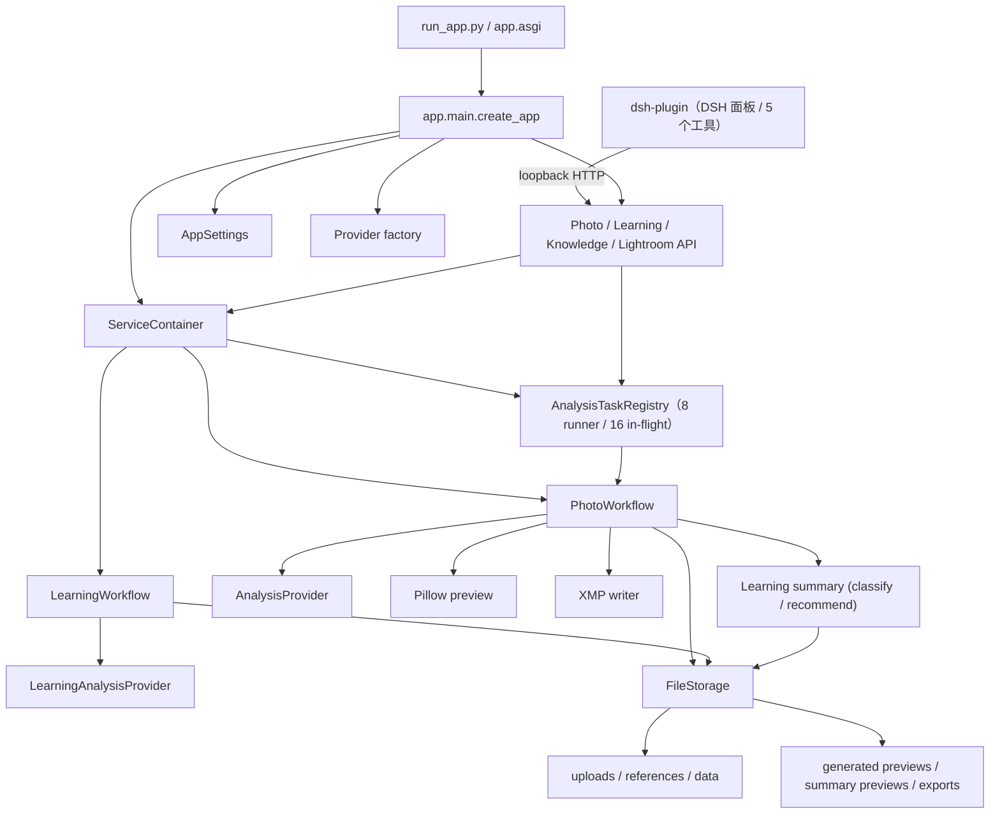

# 当前全部代码索引与架构说明

> 本文以当前工作区代码为准，用于共享项目的完整代码范围、模块边界和阅读顺序。

## 1. 代码规模与技术栈

当前仓库包含约 11,300 行 `app/` Python 代码、2,947 行 `app/static/index.html`、4,000 行 Lightroom Lua 插件（13 个文件）、1,300 行 `scripts/` 脚本，以及 `dsh-plugin/` 下约 5,900 行 JS/ESM 插件代码；自动化测试代码位于 `tests/`。应用采用 Python 3.12、FastAPI、Pydantic 2、Pillow、OpenAI Python SDK、Codex CLI 和原生 HTML/CSS/JavaScript，不依赖前端构建工具；Lightroom 侧为 Lightroom Classic SDK 6+ 的 Lua 插件（插件版本 1.7.2，`LrSdkVersion=10.0`、`LrSdkMinimumVersion=6.0`）；`dsh-plugin` 是 DeepSeek Harness 的持久化插件（`@local/dsh-photo-agent` 0.2.0），复用本机 FastAPI 后端。

运行依赖固定在 `requirements.txt`：

| 依赖 | 当前版本 | 作用 |
| --- | --- | --- |
| FastAPI | 0.165.0 | HTTP API、依赖注入、OpenAPI |
| Starlette | 1.10.0 | ASGI 工具与 TestClient 兼容层 |
| anyio | 4.16.0 | Starlette TestClient 的异步运行层 |
| Uvicorn | 0.54.0 | ASGI 本地服务器 |
| python-multipart | 0.0.34 | JPEG/PNG 表单上传 |
| Pillow | 13.0.0 | 图片校验、元数据读取和近似预览 |
| Pydantic | 2.14.4 | 领域模型、请求响应模型和 Provider 输出校验 |
| OpenAI | 2.46.0 | Responses API、图片输入和 Pydantic 结构化输出 |
| pytest/httpx/httpx2 | 9.0.3/0.28.1/2.16.2 | 服务、API、并发和故障注入测试 |

### 完整代码文件清单

下表覆盖当前所有应用、前端、脚本与测试代码文件；`__init__.py` 是包边界标记，其余文件的职责在后续章节展开。行数按当前源码逐行统计（包含空行）。

| 文件 | 行数 | 所属职责 |
| --- | ---: | --- |
| `run_app.py` | 5 | CLI 启动入口 |
| `app/__init__.py` | 1 | 应用包标记 |
| `app/asgi.py` | 10 | 默认 ASGI 实例 |
| `app/config.py` | 257 | 环境配置、Provider 选择与上传/像素/DeepSeek/OpenAI/Codex 限制 |
| `app/container.py` | 17 | 服务依赖容器 |
| `app/errors.py` | 49 | 领域异常 |
| `app/imaging.py` | 88 | 位深/色彩模式归一化与 RGB 展平 |
| `app/launcher.py` | 105 | 本地服务器、回连 URL 与浏览器启动 |
| `app/main.py` | 304 | 应用工厂、lifespan、Provider bundle、路由/错误/静态目录与请求守卫装配 |
| `app/schemas.py` | 928 | 领域、Provider 结果、持久化、后台分析任务与 API Schema |
| `app/knowledge_schemas.py` | 305 | Phase 2 学习总结与知识库 DTO（图像快照/分析快照/方向与推荐强度/8 维标签/图片风格计数/人工选择方向/列表与概览） |
| `app/api/__init__.py` | 1 | API 包标记 |
| `app/api/dependencies.py` | 9 | 请求级容器依赖 |
| `app/api/photos.py` | 217 | Phase 1 HTTP API（上传/显示/同步分析与后台任务/预览/导出/develop/lightroom） |
| `app/api/learning.py` | 105 | Phase 2 HTTP API |
| `app/api/knowledge.py` | 340 | Phase 2 学习总结与知识库 HTTP API（目录筛选/风格过滤/近似搜索/详情/概览/重建） |
| `app/api/lightroom.py` | 36 | Lightroom 状态与插件安装 API |
| `app/adapters/__init__.py` | 1 | Provider 包标记 |
| `app/adapters/analysis.py` | 208 | 照片 Provider 契约与 Mock |
| `app/adapters/factory.py` | 92 | 照片/学习 Provider bundle 工厂 |
| `app/adapters/deepseek_analysis.py` | 372 | DeepSeek 图片输入、严格 Schema、动态风格分析与重试退避 |
| `app/adapters/learning.py` | 116 | 窄学习结果契约与 Mock |
| `app/adapters/model_image.py` | 96 | 共用模型图片转正、缩放、源模式 ICC 色彩管理和元数据剥离 |
| `app/adapters/vision_models.py` | 217 | 版本化 Prompt 与严格照片/学习 wire models |
| `app/adapters/openai_analysis.py` | 171 | OpenAI Phase 1 视觉分析适配器 |
| `app/adapters/openai_learning.py` | 195 | OpenAI Phase 2 多图学习适配器 |
| `app/adapters/codex_cli.py` | 270 | Codex 隔离运行、严格 Schema、最小环境和错误映射 |
| `app/adapters/codex_analysis.py` | 74 | Codex CLI Phase 1 适配器 |
| `app/adapters/codex_learning.py` | 104 | Codex CLI Phase 2 多图适配器 |
| `app/services/__init__.py` | 1 | 服务包标记 |
| `app/services/workflows.py` | 867 | Phase 1/2 用例、结果复验、8 图前置限制、后台分析包装、可信合并与学习总结生成 |
| `app/services/series.py` | 605 | 纯 Pillow 照片签名、dHash 相似匹配、locked/aligned/context 系列策略与参考摘要 |
| `app/services/storage.py` | 862 | 文件、JSON、锁、并发 8 图封顶、原图文件名、重分析失效、人工选择记录、知识库与资产存储 |
| `app/services/preview.py` | 1,168 | Pillow preview v5 近似渲染 |
| `app/services/xmp.py` | 235 | Lightroom XMP 生成（含分通道曲线与全部 crs 高级属性） |
| `app/services/parameter_specs.py` | 547 | 57 个显影参数的单一事实源（键名、范围、中性值、预览支持度） |
| `app/services/parameters_text.py` | 112 | 参数摘要文案（Web 与 Lightroom 共用） |
| `app/services/image_formats.py` | 433 | JPEG/PNG/TIFF/CR3 识别、校验、CR3 内嵌 JPEG 提取与显示预览生成 |
| `app/services/lightroom_develop.py` | 114 | 内部参数到 Lightroom SDK `develop_settings` 映射 |
| `app/services/lightroom_bridge.py` | 405 | Lightroom 目录探测、预设/插件安装和任务队列 |
| `app/services/analysis_tasks.py` | 325 | 后台分析任务注册表、8 runner / 16 in-flight 上限、状态回收与取消 |
| `app/services/edit_resolver.py` | 814 | 基于 512px 真实渲染观测的参数解析与纠偏 |
| `app/services/measurements.py` | 347 | 纯 Pillow 图像量化测量与 Provider 提示词测量块 |
| `app/services/learning_summary.py` | 1,852 | 学习总结的确定性分类（8 维受控词表：题材/光线/色彩/影调/构图/待改善/人像风格/环境背景 + 测量补充 + 互斥标签消解 + 均衡标签预算）与智能推荐强度 |
| `app/static/index.html` | 2,947 | Phase 1/2 中文单页 UI、修图/知识库双界面切换、知识库目录树 + 原图图片墙 + 小红书式笔记弹层（原图/修图双图对照、人工选择方向）+ 近似搜索、后台分析进度和 Lightroom 联动区 |

脚本：

| 文件 | 行数 | 所属职责 |
| --- | ---: | --- |
| `scripts/validate_codex_vision.py` | 205 | 仅合成图的 Phase 1/2 真实 Codex 验证 |
| `scripts/demo_lightroom_flow.py` | 157 | JPG/TIFF/CR3 + Lightroom 桥接全链路演示 |
| `scripts/evaluate_editing.py` | 153 | 编辑参数/渲染质量评估辅助脚本 |
| `scripts/validate_lightroom_plugin.py` | 798 | Lua 语法、包完整性、Json.lua、桥接轮询与审阅窗口运行时校验 |

测试：

| 文件 | 行数 | 所属职责 |
| --- | ---: | --- |
| `tests/test_api.py` | 750 | Phase 1/2 HTTP 全流程与错误契约 |
| `tests/test_app_factory.py` | 403 | 工厂、配置、静态目录与前端守卫 |
| `tests/test_analysis_tasks.py` | 337 | 后台分析任务生命周期、取消与并发上限 |
| `tests/test_analysis_prompt.py` | 89 | Prompt 版本、测量块与 `_build_payload` 结构 |
| `tests/test_backend_hardening.py` | 478 | 代码审查 B01–B15 回归（任务并发、server_url、请求守卫、分数旋转等） |
| `tests/test_codex_analysis.py` | 171 | Codex Phase 1 参数、Schema、隔离和错误测试 |
| `tests/test_codex_learning.py` | 181 | Codex Phase 2 多图、顺序、脱敏、环境和错误测试 |
| `tests/test_deepseek_analysis.py` | 289 | DeepSeek 请求、Schema、重试退避与错误映射 |
| `tests/test_high_bit_depth_tiff.py` | 122 | 16 位 TIFF 解码与像素上限 |
| `tests/test_image_format_support.py` | 317 | TIFF/CR3 上传、预览提取、显示端点与参考图边界 |
| `tests/test_launcher.py` | 24 | 启动器 host/port 与浏览器就绪打开 |
| `tests/test_lightroom_plugin.py` | 1,105 | 显影参数、桥接任务、插件安装与 Lua 包完整性 |
| `tests/test_measurements.py` | 121 | 直方图统计、中性色与派生 EV 判断 |
| `tests/test_openai_analysis.py` | 277 | OpenAI SDK 请求、Schema、图片准备、ICC 顺序和错误测试 |
| `tests/test_openai_learning.py` | 153 | OpenAI 多图请求、结果数量和错误测试 |
| `tests/test_parameter_specs.py` | 235 | 参数规格表、overrides 折叠与编码/中性判定 |
| `tests/test_photo_identity.py` | 160 | 上传原始文件名记录、脱敏与桥接任务身份字段 |
| `tests/test_preview_advanced.py` | 277 | v5 预览高级参数（黑白、曲线、暗角、颗粒、去边）测试 |
| `tests/test_preview_parameter_coverage.py` | 268 | HSL、明暗分区、色彩分级和降噪预览测试 |
| `tests/test_renderer_fidelity.py` | 381 | 渲染器 v5 像素保真与零参数恒等 |
| `tests/test_resolver.py` | 438 | 基线校正、软膝曲线、回渲染校验的收敛/异常/上限 |
| `tests/test_services.py` | 394 | 核心服务、算法、原子失败和资产事务测试 |
| `tests/test_storage_hardening.py` | 523 | 存储安全、原子性、并发封顶与重分析失效 |
| `tests/test_learning_summary.py` | 760 | 学习总结分类与推荐强度纯函数：8 维词表、测量补充、互斥标签、12 标签均衡预算、主分类回退与强度区间 |
| `tests/test_knowledge_api.py` | 417 | 知识库 API：自动总结、目录筛选（标签/维度/风格/主分类）、近似搜索、分页、详情、概览、重建与错误契约 |
| `tests/test_xmp_and_schema_hardening.py` | 395 | 非空内容 Schema 与 XMP 加固 |

### Lightroom 插件（`lightroom/AIPhotoAgent.lrplugin/`）

插件包版本 1.7.2（`Info.lua` 的 `VERSION`），SDK 10.0、最低 6.0；13 个运行时 Lua 文件，另含 `Config.local.example.lua`、`ReviewWindowTopmost.ps1`（223 行）、`README.md` 与 `review-state.json` 状态文件。关键文件：

| 文件 | 行数 | 职责 |
| --- | ---: | --- |
| `Actions.lua` | 2,360 | 菜单动作、上传分析、风格/强度调整、虚拟副本应用与桥接任务消费 |
| `ReviewWindow.lua` | 645 | 浮动审阅窗口（预览写入、风格/强度选择与确认） |
| `ProgressWindow.lua` | 317 | 后台上传/分析/应用进度面板与取消 |
| `Json.lua` | 279 | 无依赖 JSON 编解码 |
| `Http.lua` | 116 | loopback HTTP、分析任务轮询与超时 |
| `Info.lua` | 54 | 插件元数据、菜单注册与版本 |
| `InitPlugin.lua` | 53 | 初始化与配置装载 |
| `Config.lua` | 70 | 默认配置；加载可选的 `Config.local.lua` 覆盖 |
| `ReviewWindowTopmost.ps1` | 223 | Lightroom 15.1 浮动窗口置顶辅助（Windows） |
| `AnalyzeSelected.lua` | 28 | “分析选中照片”菜单入口 |
| `ShowReview.lua` | 27 | 打开审阅窗口菜单入口 |
| `ApplyPending.lua` | 20 | “应用 Web 端待处理修图”菜单入口 |
| `OpenWeb.lua` | 20 | 打开 Web UI 菜单入口 |
| `ShowStatus.lua` | 20 | 插件状态/连接信息菜单入口 |

### DSH 插件（`dsh-plugin/`）

`@local/dsh-photo-agent` 0.2.0（`package.json`），约 5,923 行 JS/ESM：Client bundle 2,194 行、Host 入口 99 行、`src/` 2,412 行（配置/路由/服务/工具/状态/错误）、`scripts/` 校验脚本 1,218 行（`check-client.mjs` 186、`check-host.mjs` 751、`smoke-backend.mjs` 281），另有 locale 与 README。插件负责探测/拉起/复用本机后端，并把同一套能力暴露为侧边栏面板（修图 / 知识库 / 状态）和 5 个 `photo_agent_*` Agent 工具；知识库 tab 通过 Host 代理路由 `GET /knowledge/overview`、`GET /knowledge/summaries`、`GET /knowledge/summaries/:id`、`POST /knowledge/summaries/:id/rebuild` 复用后端 `/api/knowledge`；校验命令见 §10。

`requirements.txt`、README、`docs/` 与 `dsh-plugin/` 的依赖声明属于依赖/文档，不计入上述应用/测试代码行数。

## 2. 总体架构



请求首先进入 API 路由。路由只负责 HTTP 参数和响应 DTO，真正的业务顺序由 Workflow 处理。Provider 工厂根据运行配置选择 DeepSeek 视觉、Mock、OpenAI API 或 Codex CLI；Workflow 调用选定 Provider、预览或 XMP 服务，并通过 FileStorage 持久化。同步分析与 `/analyze/jobs` 后台分析共用同一 Workflow，后台任务由 `AnalysisTaskRegistry` 限流并在应用退出时通过 FastAPI lifespan 取消；`dsh-plugin` 只是另一调用方，不重写图像或模型逻辑。该分层让不同模型入口、Web UI、Lightroom 插件和 DSH 插件共用 API 与存储契约。

## 3. 根目录和运行入口

| 文件 | 代码功能与实现 |
| --- | --- |
| `run_app.py` | 最薄的 CLI 入口，仅导入并调用 `app.launcher.main()`，避免启动逻辑重复。 |
| `requirements.txt` | 固定运行和测试依赖版本，保证本地环境可复现。 |
| `README.md` | 英文项目入口、运行方式、当前范围和限制。 |
| `README.zh-CN.md` | 中文项目入口，并链接当前代码分析文档。 |
| `dsh-plugin/` | DeepSeek Harness 持久化插件：侧边栏「AI 修图」面板（修图 / 知识库 / 状态）+ 5 个 `photo_agent_*` 工具，探测并复用本机 FastAPI 后端。 |

## 4. 应用装配与基础设施

### `app/asgi.py`

Uvicorn 的默认运行入口，执行 `app = create_app()`。把默认实例放在独立模块后，`app.main` 可被测试导入而不立即读取环境或创建目录。

### `app/main.py`

`create_app(...)` 是应用组合根，支持注入 `AppSettings`、`FileStorage`、照片 Provider、学习 Provider、`LightroomBridge`、Lightroom 回连 `server_url` 和 `AnalysisTaskRegistry`（后两者主要用于测试与 launcher 桥接）。主要实现步骤：

1. 检查 `settings` 与 `storage` 不能同时传入，避免配置来源含糊。
2. 未注入 storage 时读取环境配置并构造 FileStorage。
3. 任一 Provider 未注入时，通过同一配置构造 photo/learning bundle，选择 DeepSeek、Mock、OpenAI 或 Codex。
4. 构造 PhotoWorkflow、LearningWorkflow、`AnalysisTaskRegistry` 和 ServiceContainer。
5. 注册照片、学习、知识库与 Lightroom 路由。
6. 仅公开挂载 `generated/previews`、`generated/summaries`（学习总结推荐强度预览）和 `exports`；原图、参考图和 JSON 不做整目录静态暴露。更具体的 `/generated/summaries` 挂载先于 `/generated`，因此学习总结预览与前缀预览共享同一公开 URL 空间。
7. 注册领域异常到 HTTP 状态码的统一映射。
8. 注册请求守卫与安全响应头：非安全方法（POST/PUT/PATCH/DELETE）声明的 `Content-Length` 超过 `storage.max_upload_bytes + 1 MiB` 时，在 multipart 解析前直接返回 413；携带非 loopback `Origin` 的写请求返回 403（无 `Origin` 的本地工具/插件调用不受影响）；`Host` 只接受 loopback 名称与测试主机，其他域名返回 400；所有响应补充 `X-Content-Type-Options`、`X-Frame-Options`、`Referrer-Policy` 和 `Cross-Origin-Resource-Policy`。
9. FastAPI lifespan 在应用退出时调用 `AnalysisTaskRegistry.shutdown()`，取消并回收后台分析线程。

错误映射为：无效输入与未知分析 Provider 400、资源不存在 404（含已回收的分析任务）、跨站写请求 403、工作流冲突 409、上传超限 413、Provider 上游失败 502、Provider 超时 504；损坏数据、Provider 输出契约错误和存储写入错误返回不泄露本机路径的通用 500。

### `app/config.py`

`AppSettings` 保存数据根目录、上传限制、照片 Provider、DeepSeek/OpenAI API、Codex CLI、Lightroom 目录与回连 URL。`load_settings()` 支持：

- `AI_PHOTO_AGENT_DATA_DIR`
- `AI_PHOTO_AGENT_MAX_UPLOAD_BYTES`，默认 256 MiB
- `AI_PHOTO_AGENT_MAX_IMAGE_PIXELS`，默认 50,000,000
- `AI_PHOTO_AGENT_ANALYSIS_PROVIDER`，`mock`、`deepseek`、`openai` 或 `codex`；环境变量未设置时运行时默认 `deepseek`
- `AI_PHOTO_AGENT_DEEPSEEK_API_KEY` / `DEEPSEEK_API_KEY`，显式设置的 Key
- `AI_PHOTO_AGENT_DEEPSEEK_CREDENTIALS_FILE`，可选的显式 YAML 凭据文件；不隐式读取其他应用的凭据库
- `AI_PHOTO_AGENT_DEEPSEEK_MODEL`，默认 `deepseek-flash`
- `AI_PHOTO_AGENT_DEEPSEEK_BASE_URL`，默认 `https://api.deepseek.com`
- `AI_PHOTO_AGENT_DEEPSEEK_TIMEOUT_SECONDS`，默认 180
- `AI_PHOTO_AGENT_DEEPSEEK_MAX_RETRIES`，默认 1；429/5xx 使用指数退避并优先遵循 `Retry-After`
- `AI_PHOTO_AGENT_OPENAI_API_KEY` / `OPENAI_API_KEY`
- `AI_PHOTO_AGENT_OPENAI_MODEL`，默认 `gpt-5.6-terra`
- `AI_PHOTO_AGENT_OPENAI_TIMEOUT_SECONDS`，默认 45
- `AI_PHOTO_AGENT_OPENAI_MAX_RETRIES`，默认 2
- `AI_PHOTO_AGENT_CODEX_EXECUTABLE`，可选 CLI 路径
- `AI_PHOTO_AGENT_CODEX_MODEL`，默认 `gpt-5.6-sol`，可覆盖
- `AI_PHOTO_AGENT_CODEX_TIMEOUT_SECONDS`，默认 600，范围 30 至 900
- `AI_PHOTO_AGENT_LIGHTROOM_ROOT`，可选；覆盖自动探测的 Lightroom 用户目录
- `AI_PHOTO_AGENT_SERVER_URL`，可选；Lightroom 桥接任务回连地址。`launcher` 会用实际 `--host/--port` 自动设置（通配地址转为 `127.0.0.1`），显式设置的值优先

空白数据目录回退到项目根；数值必须是正整数。`AppSettings` 数据类默认 Provider 为 `mock`（纯库/测试调用），而 `load_settings()` 的环境默认值为 `deepseek`，两者由同一组 `DEFAULT_LIBRARY_ANALYSIS_PROVIDER` / `DEFAULT_ENV_ANALYSIS_PROVIDER` 常量表达。FileStorage 还会确保像素上限不高于 Pillow 自身的解压安全阈值。

### `app/env_file.py`

无第三方依赖的 `.env` 读取器：支持 UTF-8 BOM、注释、单双引号、`export ` 前缀，忽略非法行；`load_env_file()` 默认只在进程环境没有该变量时写入，已有环境变量优先。`run_app.py` 在启动前加载仓库根 `.env`，因此命令行/系统环境变量始终可以覆盖本地文件。

### `app/container.py` 与 `app/api/dependencies.py`

`ServiceContainer` 持有共享的 storage、PhotoWorkflow、LearningWorkflow 和 LightroomBridge。`get_services(request)` 从 `request.app.state.services` 取出同一实例，保证 API、静态文件根、工作流和 Lightroom 桥接不会误用不同数据目录。

### `app/errors.py`

定义业务异常层级，使服务代码不依赖 FastAPI：

- `InvalidRequestError`：文件、URL 或输入无效。
- `UploadTooLargeError`：字节数或像素数超限。
- `ResourceNotFoundError`：资源 ID 不存在。
- `WorkflowConflictError`：缺少前置状态或并发快照失效。
- `StoredDataError`：JSON、ID 或文件归属被破坏。
- `StorageOperationError`：文件系统写入失败。
- `ProviderOutputError`：Provider 返回结构违反契约。
- `ProviderServiceError`：上游 Provider 请求失败。
- `ProviderTimeoutError`：上游 Provider 超时。

### `app/launcher.py`

实现本地启动体验：解析 host、port、reload、是否打开浏览器和等待超时；`frontend_url()` 把通配地址映射到 loopback 并正确格式化 IPv6；`server_url()` 基于同一 host/port 生成回连基地址。启动时若未显式设置 `AI_PHOTO_AGENT_SERVER_URL`，`main()` 会在 uvicorn 导入 `app.asgi` 之前把实际 `--host/--port` 写入该环境变量，保证 Lightroom 桥接任务与插件回连到真实端口（而非写死 8000）。后台线程轮询 HTTP 就绪后再打开浏览器；最后启动 `app.asgi:app`。

## 5. API 路由

### `app/api/photos.py`

包含 Phase 1 十个端点：上传、显示原图/显示图、同步分析、后台分析任务的提交/轮询/取消、预览、导出、`develop`（Lightroom 显影参数）和 `lightroom`（预设/插件/任务队列）。后台分析写入 `AnalysisTaskRegistry`，轮询与取消都会校验任务确实属于该照片；未知或已回收任务返回 404，未知 Provider 返回 400。路由不直接读写磁盘，只将 UploadFile 或 Pydantic 请求交给 PhotoWorkflow / LightroomBridge / AnalysisTaskRegistry，并通过 `response_model` 限定公开数据。

具体路径：

- `POST /api/photos`、`GET /api/photos/{photo_id}/display`
- `POST /api/photos/{photo_id}/analyze`
- `POST /api/photos/{photo_id}/analyze/jobs`、`GET /api/photos/{photo_id}/analyze/jobs/{task_id}`、`POST /api/photos/{photo_id}/analyze/jobs/{task_id}/cancel`
- `POST /api/photos/{photo_id}/preview`、`POST /api/photos/{photo_id}/export`
- `POST /api/photos/{photo_id}/develop`、`POST /api/photos/{photo_id}/lightroom`

### `app/api/lightroom.py`

提供 `GET /api/lightroom/status` 和 `POST /api/lightroom/install-plugin`，用于 Web UI 展示 Lightroom 探测状态和安装 `.lrplugin`；插件安装与队列写入仍由 `LightroomBridge` 校验目录与预设名。

### `app/api/learning.py`

包含 Phase 2 五个端点：`POST /api/learning/sessions`（创建主题）、`GET /api/learning/sessions/{session_id}`、`GET /api/learning/sessions/{session_id}/references/{reference_id}/image`、`POST /api/learning/sessions/{session_id}/references`（上传参考图）和 `POST /api/learning/sessions/{session_id}/analyze`。参考图片通过受控 GET 接口读取：先验证 session/reference 归属，再返回 FileResponse，防止通过猜路径读取其他会话文件。网页「修图」界面已不再包含参考图学习板块；这些接口与 `photo_agent_learning` 插件工具仍保留，用于后端/工具侧兼容。

### `app/api/knowledge.py`

Phase 2 学习总结与知识库接口，列表/详情/概览均为只读投影，另提供单张重建：

- `GET /api/knowledge/summaries`：按 `tag`、`dimension`、`category`、`style` 过滤，按 `q` 做标签/风格/主分类/文件名的近似搜索（子串 + `SequenceMatcher` ≥ 0.55，多关键词为 AND），并分页（`limit` 1–200 默认 50、`offset` ≥ 0），返回 `items`、`total`、全量 `facets`、`primary_categories` 与按方向统计的 `style_tags`；`dimension` 必须是八个标签维度之一，只带 `dimension` 不带 `tag` 返回 400。
- `GET /api/knowledge/summaries/{photo_id}`：单张照片的完整学习总结（图像快照、分析快照、3 个方向及推荐强度/参数总结/预览）。
- `POST /api/knowledge/summaries/{photo_id}/rebuild`：为已分析照片重建总结（未分析返回 409），用于回填旧照片或修复缺失预览。
- `GET /api/knowledge/overview`：总览（总结数、覆盖分类数、平均推荐强度、最近生成时间、facets、分类计数与 `style_tags`）。

筛选在进程内完成（本地单进程 MVP），结果固定按 `generated_at` 降序；`facets`/`primary_categories` 始终基于全量总结统计，避免前端在筛选后失去可选项。DSH 插件通过 Host 代理路由 `GET /knowledge/overview`、`GET /knowledge/summaries`、`GET /knowledge/summaries/:id`、`POST /knowledge/summaries/:id/rebuild` 复用这些接口。

## 6. 领域模型

`app/schemas.py` 是跨 API、Workflow、Provider 和持久化层共享的契约中心：

- 编辑参数模型：曝光、基础影调、白平衡、HSL、色调曲线、色彩分级、锐化、降噪和裁切建议。
- `EditingParametersV1.scaled()`：在明确中性基线与目标参数之间插值，0% 表示无风格调整，100% 保留完整风格。
- `has_adjustments()`：决定 XMP 是否应声明 `HasSettings=True`。
- `EditingStyle`：风格 ID、说明、适用理由、视觉影响和参数；名称必须可安全写入 XML 1.0。
- `ImageAnalysis`：非空、有界的技术、构图、色彩观察，以及恰好三个且 ID 唯一的推荐风格。
- `PhotoSession`：私有原图路径、元数据、分析和生成资产索引，以及 `original_filename`（上传文件名的 basename，已脱敏、≤255 字符，未知为 null；仅用于展示与 Lightroom 身份校验，绝不保存绝对路径）。`manual_edit` 记录用户在网页端最近一次主动选择并渲染的风格与强度（含参数总结、生效强度、校验状态、预览 URL 与来源），重新分析时清除。
- 后台分析任务 DTO：`AnalysisTaskCreated` / `AnalysisTaskStatus`（stage、progress_hint、error、阶段时间戳；只有 `succeeded` 状态携带 analysis，取消/失败不会泄漏被丢弃的结果）。
- 学习模型：LearningReferenceAnalysis、LearningSummary、LearningReference、LearningSession；单次真实分析最多 8 张图。
- 知识库模型（`app/knowledge_schemas.py`）：`PhotoLearningSummary`（图像快照、分析快照、恰好 3 个方向、8 维分类标签、主分类与中文 `overview`）、`EditingDirectionSummary`（方向、参数总结、智能推荐强度与中文理由、实际生效强度、`verified`/`warnings`、预览 URL）、`KnowledgeImage`/`KnowledgeAnalysisSnapshot`/`KnowledgeTag`、`KnowledgeStyleCount`（按风格名统计照片数，供目录树使用）、`KnowledgeManualEdit`（用户最近一次手动选择的风格/强度/参数总结/校验状态/预览 URL 与来源），以及列表/概览响应 DTO；`id` 必须等于 `photo_id`，方向 `style_id` 唯一、标签去重。
- `PreviewResponse` 新增 resolution 诊断字段 `verified`/`warnings`/`baseline_notes`，让学习总结能记录推荐强度为何被降档或校验通过。
- `LearningAnalysisResult`：Provider 只能返回 reference ID、单图 analysis 和 summary，不能返回整个 session 或控制路径/来源。
- Lightroom DTO：`ExportResponse` / `DevelopResponse` 的本地 `preset_path` 以 `exclude=True` 从 HTTP 隐藏；状态/安装/发送响应只在本地 UI 场景暴露 Lightroom 目录、桥接收件箱与回连 URL。
- 公共 DTO：照片上传、预览、导出和学习响应；学习 DTO 明确排除 `image_file` 私有路径。

资源 ID 统一限定为 32 位小写十六进制 UUID，风格 ID 只允许安全的字母数字、下划线和连字符格式。

## 7. Provider 适配器

### `app/adapters/analysis.py`

`AnalysisProvider` 约定接收真实图片路径和 ImageMetadata，返回 ImageAnalysis。运行时默认使用 `DeepSeekAnalysisProvider`：把去元数据、最长边 2048 的图片发给 `deepseek-flash`，由模型返回该照片专属的诊断和 3 个动态风格。请求遇到 429/500/502/503/504 或超时/连接错误时按指数退避与抖动重试，并优先遵循 `Retry-After`（上限 8 秒）；Mock 仍保留用于离线测试，但不再是默认路径；Mock 的固定风格不代表真实视觉判断。

### 视觉 Provider 公共层

`app/adapters/factory.py` 根据 `AI_PHOTO_AGENT_ANALYSIS_PROVIDER` 一次构造照片和学习
Provider bundle。`deepseek` 模式下照片走 DeepSeek 视觉分析，学习仍用 Mock；`model_image.py` 为 DeepSeek/OpenAI/Codex 统一生成 EXIF 转正、最长边 2048、
sRGB/JPEG、无源元数据的模型副本；`vision_models.py` 保存版本化安全 Prompt 和严格
照片/学习输出模型。

`openai_analysis.py` 与 `openai_learning.py` 使用 Responses API、Pydantic parse、
`store=False`、SDK timeout/retry 和明确 502/504/500。Phase 2 在一次请求中按顺序附加
最多 8 张图片，结果数量必须与输入一致。没有 API Key 时应用拒绝启动；失败不回退 Mock。

`codex_analysis.py` 与 `codex_learning.py` 复用 `codex_cli.py`。公共运行层使用临时目录、
ephemeral 会话、只读 sandbox、严格 JSON Schema、最小环境白名单，并禁用 shell、plugins、
apps、browser、computer 等无关能力。WindowsApps CLI 可缓存到 git 忽略目录；运行准备、
timeout、非零退出和输出错误均有明确语义。当前合成图真实探针已分别跑通 Phase 1 和 Phase 2。

### `app/adapters/learning.py`

`LearningAnalysisProvider` 接收只读使用的 LearningSession 上下文，但只返回窄
`LearningAnalysisResult`。默认 Mock 为每张参考图生成构图结构、主体位置、视觉层级、
调色板、影调、标签和练习经验，再按横竖图数量生成主题总结。Workflow 重新校验结果 ID
和顺序，并只把 analysis/summary 合并回可信 session。

## 8. 服务与持久化

### `app/services/workflows.py`

PhotoWorkflow 编排上传、分析、参数缩放、预览、XMP 导出和资产登记。生成资产 token 基于风格 ID、有效参数和渲染/映射版本的 SHA-256 摘要，避免相同输出重复生成，也避免不同有效参数覆盖。

分析成功并写回 session 后，`analyze_with_progress` 会继续调用 `build_learning_summary` 生成 Phase 2 学习总结：用 `measure_file` 量化原图，`classify_analysis` 产出 8 个维度（题材场景/光线/色彩/影调/构图/待改善/人像风格/环境背景）的标签与主分类，`recommend_intensity` 为 3 个风格分别计算推荐强度；每个方向再用 `_resolve_parameters` 在候选强度（推荐值、-10%、-20%）上逐档校验，未通过就自动降档，随后渲染到 `generated/summaries/<photo_id>/` 并把 intensity reason、warnings 与基线校正写入总结。标签总预算 12 个、每维最多 2 个，并先保证每维一个再补第二标签，避免人像/环境目录被高维词挤空。总结生成是 best-effort：任何异常只记录日志，绝不推翻已保存的分析结果；分析变化时旧总结与旧预览目录会被删除，也可随时通过 rebuild 重建。用户主动预览或导出成功后，Workflow 会把所选风格、强度、参数总结、生效强度、校验状态和预览 URL 写入 `PhotoSession.manual_edit`（导出时 `source=export` 并尽量关联已有推荐强度预览）；知识库详情读取时由 Workflow 实时补充到 `PhotoLearningSummary.manual_edit`，因此 rebuild 不会丢用户选择。

LearningWorkflow 编排主题、参考图、来源 URL 校验和分析。上传前限制 session 最多 8 图，
分析前再次限制最多 8 图并记录
reference ID 快照；Provider 返回后验证窄结果的 reference ID 顺序与完整性，再把分析合并
到可信 session。保存时再次比较最新快照，参考图在分析期间变化则返回 409；Provider
service/timeout/output 错误分别保持 502/504/500。

### `app/services/series.py`

系列一致性是 Provider 之外的确定性 best-effort 层。`compute_signature()` 用 Pillow 计算
64-bit dHash（9×8 灰度逐行比较，不需要 numpy）以及宽高比、平均亮度、平均饱和度，
`SignatureCache` 把结果原子写入 `data/signatures/<photo_id>.json`，并按源文件
`mtime_ns`/`size` 失效。`find_series_matches()` 只比较当前版本（`photo_analysis_v2`）
的已分析 session：dHash≤6 且宽高比差≤0.03 为 `duplicate`，同文件名前缀且编号差≤50
为 `sequence`，否则用 0.55/0.15/0.15/0.15 的加权相似度取 `visual`；最多 3 个参考。
`build_series_state()` 决定 `locked`（其他 session 近似重复）、`aligned`（自己重分析、
连拍、强视觉相似）或 `context`；`build_consistency_context()` 生成不超过 2400 字的参考
摘要并声明“参考不是指令”。`apply_series_analysis()` 在 `locked` 时精确复用参考的 3 套
风格，在 `aligned` 且参考无黑白时过滤本次黑白并尽量从参考的彩色风格补齐到 3 套。
签名/匹配/应用失败只记录 warning，不改变 Provider 结果。

### `app/services/storage.py`

FileStorage 同时承担本地 blob 存储和 JSON repository：

- 上传按最多 1 MiB 分块读取，并在业务层限制总字节数；请求层还会用 `Content-Length` 在 multipart 解析前拒绝声明超限的写请求（上限 + 1 MiB 余量，413）。
- Pillow 先 `verify()` 再重新打开并 `load()`，拒绝只有有效头部的截断图片。
- 支持 JPEG、PNG、TIFF、CR3（CR3 使用相机内嵌 JPEG 预览），并将 Pillow 识别的 MPO 规范化为 JPEG。
- 上传时记录脱敏后的原始文件名（basename、≤255 字符、控制字符丢弃、未知为 null）到 PhotoSession，供 Lightroom 任务身份校验；磁盘仍使用 `original<ext>` 命名。
- 读取 EXIF Orientation 后交换视觉宽高。
- 资源 ID、模型内部 ID、文件名和文件归属路径均做严格校验。
- JSON、预览和 XMP 使用临时文件、flush/fsync 和 `os.replace` 原子发布。
- 同一数据根的多个 FileStorage 实例共享进程内 RLock，避免并发丢更新。
- 参考图提交时锁内重载最新 session，原子封顶 8 张，并使旧 summary 失效。
- 学习总结以私有 JSON 保存在 `data/knowledge/summaries/<photo_id>.json`，文件名/内部 ID 严格校验、原子写并复用同一根锁；列表读取跳过非 32 位十六进制文件，损坏记录按 `StoredDataError` 处理，不静默丢弃。
- 学习总结的推荐强度预览写入 `generated/summaries/<photo_id>/` 并在重建时整目录替换；它们刻意不登记到 `PhotoSession.preview_files`，避免与用户主动预览的资产失效语义混在一起。
- 支持读取旧 `generated/sessions` 和 `generated/learning_sessions`，新写入统一迁移到私有 `data/`。

### `app/services/analysis_tasks.py`

后台分析任务注册表（`analysis_task_v1`）：Web 与 Lightroom 插件通过 `/analyze/jobs` 提交后，把一个 provider 调用放进独立 daemon 线程。最多 8 个未取消 runner，同时最多 16 个 live 线程（`ANALYSIS_TASK_MAX_IN_FLIGHT = 8 * 2`），超过上限的新任务直接返回 failed 状态而不是排队；取消会立即释放 runner 名额，但无法中止已发出的 provider HTTP 调用，线程在超时或返回后自行退出。任务状态字段在锁内更新，进程内任务按 finished_at 保留 1 小时后回收；FastAPI lifespan 退出时调用 `shutdown()` 取消活跃任务。

### `app/services/preview.py`

Pillow `pillow_preview_v5` 近似渲染器：`render_preview()` 负责 EXIF 转正、RGB 转换、
最大 1600 像素缩放并原子写出 JPEG；像素运算集中在无 IO 的纯函数
`render_image(image, parameters)` 里，顺序为白平衡 → 合成色调 LUT → 分通道曲线 → 黑白 →
存在感 → HSL → 色彩分级 → 清晰度/纹理 → 降噪 → 镜头暗角 → 去边 → 裁剪后暗角 → 颗粒 → 锐化。
色调合成为一个单调 LUT（线性光 EV 曝光、encoded S 曲线对比、smoothstep 阴影/高光、tone curve，
`lut[0] == 0`），再用比例乘应用，因此任何参数都不会把纯黑抬成灰；白平衡在线性光下做 log 增益
并保持亮度；暗角/颗粒/去边在参数中性时跳过，颗粒用参数哈希播种以保证可复现。其结果仍明确标记为
approximate，不等同于 Camera Raw。

### `app/services/measurements.py`

纯 Pillow 的图像量化测量（`image_measurements_v1`）：每通道
`mean/std/p01..p99/clip_low/clip_high`、`range_90`、饱和度与色度、
中性色区域的红/蓝比与覆盖率、暗部/高光/平坦占比，派生 `mid_tone_ev_delta`、
`warm_bias`、`is_low_key`/`is_high_key` 与中文判断短语。`describe_for_prompt()`
把同一批数字渲染成确定性文本，供视觉模型参考。

### `app/services/edit_resolver.py`

`edit_resolver_v1`：`resolve_parameters()` 用测量结果算出基线校正
（曝光基准、阴影、高光、对比、去灰、自然饱和度、色温），叠加风格参数后，
在 512px 上真实渲染并重新测量做最多 2 轮纠偏，返回 `Resolution`（参数 + 校验报告）。
`intensity == 0` 时直接返回精确中性参数，不测量也不校验。

### `app/services/xmp.py`

使用 ElementTree 构造合法 XMP/RDF，而不是字符串拼接。它输出 Camera Raw 基础参数、完整 HSL、色调曲线、色彩分级、锐化和降噪字段；preset UUID 由名称、映射版本和规范化参数生成 UUIDv5，保证相同内容稳定一致。当前映射版本为 `lightroom_xmp_v2`。

## 9. 前端代码

`app/static/index.html` 是 2,947 行无构建单页应用，分为「修图」与「知识库」两个顶层界面，由顶部导航按钮双向切换（`#studioViewBtn` / `#knowledgeViewBtn`，用 `aria-pressed` 标记当前界面；首次进入知识库时懒加载数据，切换时复位滚动位置），含 Lightroom 联动：

- Phase 1：上传并分析（同步或 `/analyze/jobs` 后台任务，显示阶段进度并可取消）、风格卡选择、强度滑杆、预览、XMP 导出、发送到 Lightroom 与插件安装/状态；五个功能标题不带数字编号。
- 网页端不再包含「摄影学习」参考图板块；对应的后端 API 与插件工具仍保留（见 §5）。
- Phase 2 学习总结与知识库（独立「知识库」界面）：左侧 sticky 目录树（全部照片 / 图片风格 / 构图 / 人像风格 / 环境背景 / 题材场景 / 光线 / 色彩 / 影调 / 待改善，分组可折叠、条目带数量），右侧 3:4 纯图片墙只显示原图（懒加载，不再混入修图预览）；点击图片以小红书笔记式弹层并排展示原图与当前修图方向预览，同时展示主分类、生成时间、标签、分析总结和 3 个修图方向（推荐强度理由、参数总结与可切换的推荐强度预览）；若该照片已在网页端选择过风格与强度，弹层额外显示「你选择过的修图方向」（风格、强度、参数总结、校验状态、来源，以及可点击查看的该次预览）。顶部搜索框以 300ms 防抖 + Enter 触发近似搜索，并可与目录条目叠加筛选；保留统计行、刷新、当前照片重建、分析成功后自动刷新与分页加载更多。
- 图片查看：上传区与预览对比区直接内联展示原图与修图预览；知识库图片墙点击打开笔记弹层，弹层内并排展示原图与当前修图方向预览，便于对照。

前端通过 `currentPayload()` 绑定 photo/style/intensity 快照，避免旧异步响应覆盖新选择；每个动作使用局部 busy/error/finally 状态；后台分析用任务轮询更新进度并在切换选择时丢弃迟到响应；所有动态用户/服务文本通过 `textContent` 创建，避免动态 `innerHTML` 注入；后端返回的资源 URL 经 `sameOriginUrl()` 检查。

## 10. 测试代码全量索引

`tests/` 下的全量测试通过。

| 文件 | 覆盖范围 |
| --- | --- |
| `tests/test_api.py` | Phase 1/2 HTTP 全流程、后台分析任务、第 9 图上传/遗留超限分析、502/504、MPO、URL、私有路径、OpenAPI 和 Provider 契约。 |
| `tests/test_env_file.py` | `.env` 解析：BOM、注释、引号、`export`、空值与进程环境优先级。 |
| `tests/test_privacy_scan.py` | 隐私扫描规则：Windows 用户目录、照片库、SID、API Key、占位符放行、未跟踪工作树文件与仓库自检。 |
| `tests/test_services.py` | metadata、EXIF、Mock 输出、参数缩放、预览、色调曲线、Tint、XMP、内容 token、原子失败和资产事务。 |
| `tests/test_storage_hardening.py` | 私有/旧目录、路径逃逸、限量/截断图、并发参考图封顶、快照冲突、文件归属和重分析资产失效。 |
| `tests/test_xmp_and_schema_hardening.py` | 非空内容、0/50/100% 插值、公共 DTO、XML/RDF、UUID、完整 XMP 和失败恢复。 |
| `tests/test_app_factory.py` | import-safe 工厂、双阶段 Provider bundle、环境配置、DeepSeek 默认/凭据、静态目录、lifespan 和前端守卫。 |
| `tests/test_analysis_tasks.py` | 后台任务阶段顺序、中文错误映射、取消后迟到结果丢弃、runner 上限与 `shutdown`。 |
| `tests/test_backend_hardening.py` | 后端审查 B01–B15 回归：任务 admission/in-flight 上限、server_url 传播、lifespan 关闭、Origin/Content-Length 守卫、分数旋转、恶意 overrides 与路径脱敏契约。 |
| `tests/test_deepseek_analysis.py` | DeepSeek 图片请求、严格 Schema、动态风格、输出重试、429/5xx 退避与 `Retry-After`、超时和错误映射。 |
| `tests/test_codex_analysis.py` | Codex Phase 1 图片参数、隔离、严格输出 Schema、超时和失败映射。 |
| `tests/test_codex_learning.py` | Codex Phase 2 多图顺序、图片去元数据、环境白名单、数量和 runtime 错误。 |
| `tests/test_openai_analysis.py` | OpenAI Phase 1 SDK 序列化、Pydantic parse、图片准备、非 RGB ICC 顺序和错误。 |
| `tests/test_openai_learning.py` | OpenAI Phase 2 有序多图、结果数量、缺失输出和 SDK 错误。 |
| `tests/test_preview_parameter_coverage.py` | 高光/阴影、HSL、色彩分级和亮度降噪必须改变相应预览区域。 |
| `tests/test_preview_advanced.py` | v5 高级参数：黑白、分通道曲线、暗角、颗粒和去边的像素效果。 |
| `tests/test_renderer_fidelity.py` | 渲染器 v5 的像素保真：EV 曝光量级、黑位不被抬起、白平衡亮度守恒、HSL 有界、色彩分级为加法调色、锐化/清晰度/纹理与零参数恒等。 |
| `tests/test_measurements.py` | 直方图统计、百分位、剪切率、中性色红蓝比与覆盖率、派生 EV 判断和 `describe_for_prompt` 文本。 |
| `tests/test_resolver.py` | 基线校正量级、目标影调分支、软膝曲线、`intensity == 0` 精确中性、回渲染校验的收敛/异常/上限。 |
| `tests/test_parameter_specs.py` | 参数规格表、overrides 折叠、编码/中性判定（含分数旋转）与「只写非中性项」。 |
| `tests/test_photo_identity.py` | 上传原始文件名记录、hostile 文件名脱敏、桥接任务 `photo.original_filename` 与旧 session 兼容。 |
| `tests/test_analysis_prompt.py` | 提示词版本与标定文案、测量块注入位置、缺图容错和 `_build_payload` 的消息结构。 |
| `tests/test_high_bit_depth_tiff.py` | 16 位 TIFF 解码、位深归一化与像素上限边界。 |
| `tests/test_image_format_support.py` | TIFF/CR3 上传、CR3 预览提取、JPEG 段遍历、显示端点、像素限制和学习参考图边界。 |
| `tests/test_launcher.py` | 通配 host、IPv6、回连 `server_url` 发布和浏览器就绪打开。 |
| `tests/test_lightroom_plugin.py` | 显影参数、桥接任务、插件安装、预设/XMP 内容与 Lua 插件包完整性。 |
| `tests/test_learning_summary.py` | 学习总结分类与推荐强度纯函数：8 维词表命中、测量补充、每维/总量上限与 12 标签均衡预算、主分类回退、强度基线/调整/夹取与中文理由文案。 |
| `tests/test_knowledge_api.py` | 知识库 API：上传→分析自动总结、列表/分页/目录筛选（标签/维度/风格/主分类）、近似搜索与 typo、详情（含人工选择方向）、概览与 `style_tags`、重建、未分析 409、非法维度 400、重分析替换与推荐强度预览静态文件。 |

### 验证命令与当前基线

```powershell
# Python 回归（.pytest_cache 在本工作区有 ACL 限制，必须加 -p no:cacheprovider）
.\.venv\Scripts\python.exe -m pytest tests -q -W error -p no:cacheprovider
# => 479 passed（32 个测试文件）

# Lightroom 插件静态/运行时校验（package, syntax, json_runtime, bridge_runtime,
# review_recall, watcher_guard, topmost_helper 全部通过）
.\.venv\Scripts\python.exe scripts\validate_lightroom_plugin.py

# DSH 插件校验（Node 路径按本机运行时调整）
$node = "C:\path\to\node.exe"
& $node dsh-plugin\scripts\check-client.mjs    # 2 个 Slot 注册、2 个 effect
& $node dsh-plugin\scripts\check-host.mjs      # 配置/资源白名单/错误映射/缓存/后端生命周期/知识库路由
& $node dsh-plugin\scripts\smoke-backend.mjs   # 真实 Python + mock Provider，41 checks
```

## 11. 运行时目录

```text
uploads/<photo_id>/original.{jpg,png,tif,cr3}
uploads/<photo_id>/display.jpg
uploads/<photo_id>/embedded.jpg                  # CR3 内嵌预览（仅 CR3）
references/<session_id>/<reference_id>/reference.{jpg,png}
data/sessions/<photo_id>.json
data/learning_sessions/<session_id>.json
data/knowledge/summaries/<photo_id>.json         # Phase 2 学习总结（私有，只经 API 投影）
data/runtime/codex-jobs/<random>/                # Codex Provider 临时工作目录，用完即删
generated/previews/<photo_id>/<content_token>.jpg
generated/summaries/<photo_id>/<content_token>.jpg  # 学习总结推荐强度预览
exports/<photo_id>/<content_token>.xmp
```

上传图、参考图与私有 JSON 不整目录公开；只有 `generated/previews`、`generated/summaries` 和 `exports` 整目录公开。参考图通过验证归属关系的 API 单文件读取，学习总结 JSON 只经知识库 API 投影输出。

Lightroom 桥接另有用户目录（不在项目 data 根下）：`<Lightroom 设置>/Modules/AIPhotoAgent.lrplugin` 为插件安装位置，`<Lightroom 设置>/AI Photo Agent Bridge/{inbox,done,failed}` 为任务队列与结果目录，预设写入 `<Lightroom 设置>/AI Photo Agent/`。

## 12. 推荐阅读顺序

1. `app/main.py` 和 `app/container.py`：先理解装配关系。
2. `app/api/photos.py`、`app/api/learning.py`、`app/api/knowledge.py`：理解公开接口。
3. `app/services/workflows.py`、`app/services/learning_summary.py`：理解两条业务主链路，以及学习总结的确定性分类与推荐强度。
4. `app/schemas.py`、`app/knowledge_schemas.py`：理解输入输出和持久化契约。
5. `app/services/storage.py`：理解安全、并发和文件布局。
6. Provider、preview、xmp：理解具体算法。
7. `app/static/index.html`：理解浏览器交互。
8. `tests/`：用测试确认边界行为和失败语义。

## 13. 当前明确限制

- 照片分析默认已改为 DeepSeek 视觉模型；真实分析依赖网络、账户配额和模型输出质量。Phase 2 参考图学习分析在 `deepseek` 模式下仍是 Mock；新增的学习总结不依赖该 Mock，而是由照片分析结果与测量确定性生成。
- OpenAI/Codex 真实视觉分析依赖外部服务、认证、账户配额和模型输出质量。Codex 合成图双阶段探针已通过，OpenAI 在线调用尚未验收。
- Pillow 预览已是 v5（基础、分通道曲线、HSL、高光/阴影、色彩分级、清晰度/纹理、暗角、颗粒、去边、亮度降噪），但仍不等同于 Camera Raw，锐化/色噪/裁切等部分语义只近似渲染。
- XMP 已通过结构测试，但仍缺 Lightroom Classic/Camera Raw 真机 golden fixture 认证。
- session 尚未持久化完整 Provider/model/prompt/schema/耗时/输入摘要 provenance。
- 后台分析任务（`/analyze/jobs`）只存在于进程内：重启即丢，任务按 finished_at 保留 1 小时，没有跨重启队列、持久化恢复或长期结果保留。
- 上传限制现在是「Content-Length 前置 413 + 分块读取时业务上限」两层，前置检查只信任客户端声明且仍会把整个文件读入内存，公网部署仍需代理/ASGI request-body limit。
- 没有认证、账户、配额和删除/保留 API；只对带非 loopback `Origin` 的写请求返回 403（无 Origin 允许，兼容 Lightroom Lua 与命令行），不是完整的 CSRF/浏览器安全边界。
- JSON repository 和进程内锁适合单进程本地 MVP，不适合多进程或多主机部署。
- Phase 2 学习总结的分类与推荐强度是确定性规则（分析文本关键词 + 图像测量 + 风格参数幅度），不额外调用模型；标签质量取决于 Provider 分析措辞，互斥标签对与词表覆盖有限，新题材/新风格需扩充 `app/services/learning_summary.py`。标签总量预算 12、每维最多 2 个，并先保证每个维度至少一个标签，避免人像风格/环境背景等尾部维度被高频维度挤空；扩大词表或维度时要同步更新均衡预算与测试。
- 知识库的筛选、近似搜索、排序与分页在进程内基于全部总结 JSON 完成；近似搜索为子串 + `SequenceMatcher`（阈值 0.55）的确定性启发式，不是语义向量检索；记录规模很大时应引入索引或数据库，当前实现以本地单进程 MVP 为准。
- 学习总结是派生数据：分析变化会删除旧总结与旧预览，需要回填或修复时用 `POST /api/knowledge/summaries/{photo_id}/rebuild` 重建。
- 人工选择（`PhotoSession.manual_edit`）只在用户通过网页预览或导出后写入；它不进入学习总结 JSON，而是在知识库详情读取时实时补充，重新分析会清除该记录；Lightroom 插件与 DSH 插件面板暂未展示这份人工选择信息。
- 前端仍集中在单个 HTML 文件，继续扩展时应拆分 CSS、JS 和组件测试。
