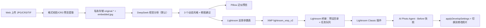

# AI Photo Agent Lightroom 修图插件

> 记录日期：2026-10-23，真机补充 2026-10-24、2026-11-11（Asia/Shanghai）  
> 功能定位：在 Web 修图闭环之上，新增可安装到 Lightroom Classic 的 `.lrplugin`，
> 把“分析 → 建议 → 参数 → 在 Lightroom 中看效果”连成可执行链路。
> 插件版本 **1.7.2** 起，评审默认回到**单个浮动窗口**；Windows 上用
> `ReviewWindowTopmost.ps1` 助手模拟 Lightroom 15.2 的强制置顶，修复
> 「切走窗口 / 点任务栏缩略图后修图窗口叫不回来」的问题（见 §6.5）。
> 置顶助手启动由 `LrTasks.pcall` 隔离，任何助手异常都不会中止评审。

---

## 1. 功能范围

| 能力 | 实现 |
| --- | --- |
| 上传格式 | JPG/JPEG、PNG、TIF/TIFF、Canon CR3 |
| CR3 处理 | 校验 ISO BMFF/`ftyp` 容器，提取容器内最大完整 JPEG 预览作为分析/渲染源；原始 `.cr3` 原样保留 |
| TIFF 处理 | Pillow 完整解码校验，支持 RGB、CMYK、16 位灰度等常见 TIFF；16 位灰度/高位深按 0–65535 线性映射到 8 位显示与模型输入，避免高光被裁剪成纯白；保留 `.tif` 原文件 |
| 修图建议 | 默认 DeepSeek 视觉分析，根据当前照片返回技术、构图、色彩观察和恰好 3 个动态风格；Mock / OpenAI / Codex 仍可选 |
| Lightroom 参数 | `lightroom_develop_v1` 映射，输出可直接传给 `LrPhoto:applyDevelopSettings` 的参数表 |
| XMP 预设 | `lightroom_xmp_v2`，与显影参数表来自同一套内部参数 |
| 送入 Lightroom | 写入预设目录 + 注册插件 + 任务队列；插件写 `AI Photo Agent - Before` 快照并应用参数 |
| 显示效果 | 应用后切换到修改照片模块；当前版本默认应用到选中照片，可用 Before 快照或 Ctrl+Z 撤销 |

> 真机状态：2026-10-24 在 `<Lightroom install>\Lightroom.exe`
> （Lightroom Classic 15.1）上，插件已注册、菜单可执行，桥接任务成功应用，
> 日志出现 `applyDevelopSettings succeeded` 并进入 `done/`。验收时对
> `D:\Photos\2026\2026-04-30\example.CR3` 执行了一次测试应用；
> 该照片的 `AI Photo Agent - Before` 快照仍可用于恢复。

## 2. 支持的图像格式

| 格式 | 识别方式 | 渲染/分析源 | 原始扩展名 |
| --- | --- | --- | --- |
| JPEG / MPO JPEG | 魔术字节 + Pillow 完整解码 | 原文件 | `.jpg` |
| PNG | 魔术字节 + Pillow 完整解码 | 原文件 | `.png` |
| TIFF | `II*\0` / `MM\0*` 头 + Pillow | 原文件 | `.tif` |
| CR3 | `ftyp` + `crx ` major brand | 容器内最大可解码 JPEG 预览 | `.cr3` |

CR3 的 `width`/`height` 是内嵌预览尺寸，并带 `render_source=embedded_preview` 标记；
不是 RAW 传感器分辨率。RAW 像素级渲染需要 LibRaw/rawpy 或 Lightroom 自身解码。

## 3. 总体链路



插件也可反向主动工作：在 Lightroom 中选中照片，走
`文件 > 增效工具附加功能 > AI Photo Agent - 分析并修图（当前照片）`
（图库模块下也可以走 `图库 > 增效工具附加功能`），
插件导出缩略图上传到本地服务，拿到分析和参数后先预览，确认后才写入照片。

分析走**异步任务 + 进度提示**：插件先创建任务，再用每秒一次的 GET 轮询任务状态，
运行期间在 Lightroom 右下角持续刷新提示条，依次显示
`排队中 → 读取与量化照片 → 模型分析中（已用 N 秒）→ 校验并保存建议 → 分析完成`。
`LrHttp.post` 会阻塞 Lightroom 主循环，所以不能用一次长请求等结果；服务端未升级
（没有 `/analyze/jobs` 端点）时插件自动回退到同步 `POST /analyze`，只是没有进度显示。

## 4. HTTP API

| 方法 | 路径 | 用途 |
| --- | --- | --- |
| POST | `/api/photos` | 上传照片，返回 `photo_id` |
| POST | `/api/photos/{photo_id}/analyze` | 同步分析（旧入口，语义不变，失败返回 502） |
| POST | `/api/photos/{photo_id}/analyze/jobs` | 创建异步分析任务，201 返回 `{task_id, photo_id, stage}` |
| GET | `/api/photos/{photo_id}/analyze/jobs/{task_id}` | 查询任务：`stage`、`elapsed_seconds`、`progress_hint`、`analysis`、`error` |
| POST | `/api/photos/{photo_id}/analyze/jobs/{task_id}/cancel` | 取消等待（不中断后台模型请求） |
| GET | `/api/photos/{photo_id}/display` | 浏览器可显示的原图/派生 JPEG（TIFF 转 JPEG，CR3 用内嵌预览） |
| POST | `/api/photos/{photo_id}/develop` | 返回 `lightroom_develop_v1` 显影参数表、XMP URL、预设名 |
| POST | `/api/photos/{photo_id}/lightroom` | 写入 Lightroom 预设、安装/提示插件、排队任务 |
| GET | `/api/lightroom/status` | 返回 Lightroom 目录、插件注册状态、桥接收件箱 |
| POST | `/api/lightroom/install-plugin` | 把 `lightroom/AIPhotoAgent.lrplugin` 复制到 Modules 目录 |

任务阶段 `stage` 取值：`queued`、`measuring`、`provider`、`validating`、
`succeeded`、`failed`、`cancelled`。任务只保存在内存（1 小时过期、2 个并发 worker），
服务重启后旧 `task_id` 查询返回 404，插件会提示重新分析。

`develop_settings` 示例（截取）：

```json
{
  "ProcessVersion": "15.4",
  "Exposure2012": 0.19,
  "Contrast2012": 9,
  "Highlights2012": -16,
  "Shadows2012": 18,
  "ToneCurveName2012": "Custom",
  "ToneCurvePV2012": [0, 0, 64, 60, 128, 128, 192, 196, 255, 255],
  "HueAdjustmentGreen": -3,
  "SplitToningShadowHue": 220,
  "Sharpness": 34,
  "LuminanceSmoothing": 6
}
```

`ToneCurvePV2012` 使用 Lightroom SDK 接受的扁平数组：`x1, y1, x2, y2, ...`。

## 5. 桥接目录与任务格式

默认 Lightroom 用户目录：

- Windows：`%APPDATA%\Adobe\Lightroom`
- macOS：`~/Library/Application Support/Adobe/Lightroom`

```text
<LightroomRoot>/
  Develop Presets/
    AI Photo Agent/
      AI Photo Agent - 自然纪实 - 70.xmp
  Modules/
    AIPhotoAgent.lrplugin/
  AI Photo Agent Bridge/
    inbox/
    processing/          # 插件领取任务后创建
    done/
    failed/
    bridge-path.txt      # 服务端写入已安装副本的桥接位置提示（不再随仓库提交）
```

任务 JSON 的关键字段：

```json
{
  "schema_version": "aipa_lightroom_job_v1",
  "job_id": "job_...",
  "server_url": "http://127.0.0.1:8000",
  "photo": {"photo_id": "...", "original_filename": "example.CR3", "style_id": "natural-documentary", "intensity": 0.75},
  "style": {"id": "natural-documentary", "name": "自然纪实"},
  "preset_name": "AI Photo Agent - 自然纪实 - 75",
  "preset_path": ".../Develop Presets/AI Photo Agent/....xmp",
  "mapping_version": "lightroom_xmp_v2",
  "develop_settings_version": "lightroom_develop_v1",
  "develop_settings": {"...": "..."},
  "parameters": {"...": "..."}
}
```

处理顺序：

1. 轮询 `inbox/*.json`；没有选中照片时保留任务。
2. 把任务移动到 `processing/` 领取，避免重复应用。
3. 校验任务目标：优先把 `photo.original_filename` 与当前选中照片的 `fileName` 按大小写不敏感比较；
   不一致时**不应用任何修图设置**，直接把任务移到 `failed/` 并提示用户在 Lightroom 中选中目标任务照片。
   旧版服务端没有该字段时仍按原行为应用，但会额外提示“无法自动校验目标照片，请核对”。
4. 在写访问内复用/创建唯一的 `AI Photo Agent - Before` 快照，并调用 `applyDevelopSettings`。
5. 选中目标照片、切换到 Develop 模块、显示提示。
6. 任务移动到 `done/`；失败移动到 `failed/`。卡在 `processing/` 超过 10 分钟的任务会被自动找回
   （最多重试 3 次，之后移入 `failed/`），`done/`、`failed/` 中超过 7 天的旧文件会被清理。

## 6. Lightroom 插件安装与使用

### 6.1 自动安装（复制到 Modules）

打开 Web 应用 “5. Lightroom 联动”，点击“安装 / 检查 Lightroom 插件”。
服务端会把插件复制到：

```text
%APPDATA%\Adobe\Lightroom\Modules\AIPhotoAgent.lrplugin
```

并写入 `bridge-path.txt`。注意：在 Lightroom Classic 15.1 真机上，仅复制到
`Modules` 会出现在增效工具管理器列表，但脚本可能没有真正初始化；需要再通过
“添加”注册一次。

### 6.2 手动添加/注册（真机验证路径）

1. 打开 Lightroom Classic。
2. `文件 > 增效工具管理器 > 添加`。
3. 选择项目中的 `lightroom/AIPhotoAgent.lrplugin` 文件夹。
4. 确认 `AI Photo Agent` 状态为“此增效工具已启用”。
5. 重启 Lightroom Classic。

插件菜单同时出现在两个位置（部分中文版把“增效工具附加功能”显示为“增效工具附加信息”，以实际菜单为准）：

- `文件 > 增效工具附加功能`：**任何模块都能看到**，包括「修改照片」，推荐日常在 Develop 模块里直接用这一条；
- `图库 > 增效工具附加功能`：只在「图库」模块可见（1.2.x 及更早版本的唯一入口）。

两个菜单下都是同样五项：

- `AI Photo Agent - 分析并修图（当前照片）`
- `AI Photo Agent - 应用 Web 端待处理修图`
- `AI Photo Agent - 连接与安装状态`
- `AI Photo Agent - 打开 Web 修图页面`
- `AI Photo Agent - 显示分析窗口`（评审窗口被挡住/切走后，点它重新弹出）

### 6.3 Web 端送入 Lightroom

1. 启动服务：`.\.venv\Scripts\python.exe run_app.py`。
2. 上传 JPG/CR3/TIF，完成 AI 分析并选择/保留风格。
3. 调整强度，点击“生成 Lightroom 参数”检查参数表。
4. 点击“发送到 Lightroom”。
5. 在 Lightroom 中选中目标照片，运行
   `文件 > 增效工具附加功能 > AI Photo Agent - 应用 Web 端待处理修图`
   （或 `图库 > 增效工具附加功能` 下的同名项）。
6. 插件写入 `AI Photo Agent - Before` 快照、应用参数并切换到修改照片模块。
7. 如需后续自动处理，先用任意插件菜单项初始化一次；watcher 会轮询新任务。

### 6.4 分析进度窗口（1.1.0）

点 `AI Photo Agent - 分析并修图（当前照片）` 之后：

1. 立刻出现提示条「正在准备照片…」——点击一定有反馈，不会"点了没反应"。
2. 插件调用 `POST /api/photos/{id}/analyze/jobs` 拿到 `task_id`，然后弹出一个
   **模态进度窗口**（`LrDialogs.showModalProgressDialog`），标题为
   「AI Photo Agent 正在分析照片」，caption 每秒刷新：
   `读取与量化照片（已用 3 秒）` → `模型分析中 — 正在调用模型分析照片（已用 21 秒）`
   → `校验并保存建议（已用 34 秒）`。进度条按阶段推进，模型阶段按耗时缓慢爬升，
   用户可点「取消」——插件会调用
   `POST /api/photos/{id}/analyze/jobs/{task_id}/cancel` 并立刻关闭窗口。
3. 分析完成后打开**一个**「AI Photo Agent - 分析与修图」浮动窗口，选风格、调强度、
   点「预览效果」都在这个窗口里完成（1.7.0 起默认；详见 §6.5）。
4. 服务端不支持 job 端点（旧版服务）时自动回退到同步 `/analyze` 并提示"无进度显示"；
   SDK 不支持模态进度窗口时回退为每秒刷新的提示条。

任何一步失败都会**弹中文错误框并写入日志**，不再静默：

```text
%LOCALAPPDATA%\Adobe\Lightroom\Logs\LrClassicLogs\AIPhotoAgent.log
```

日志关键字：`menu: analyze invoked`（点击已到达）、`analyze: job <id> created`、
`analyze: succeeded` / `analyze: failed: ...`、`self-check: ... service=ok`。

### 6.4.1 取消语义（1.3.1）

点「取消」只结束等待、不打断已经在飞的 HTTP 请求，但**必须立刻释放并发名额**，
否则下一次分析会排在一条废弃任务后面，看起来像"队列卡住"：

- 插件把取消请求发给服务端，失败会重试一次，并写入日志
  `progress: cancel acknowledged by the service` /
  `progress: cancel could not be delivered: ...`。
- 服务端 `AnalysisTaskRegistry` 在取消时立即释放并发名额（每个任务一个 daemon 线程，
  不是固定线程池），所以下一次分析**立刻开始**，不会被废弃任务挡住。
- 被取消的任务即使稍后返回结果也会被丢弃，**不会写回 photo session**：
  取消不会偷偷覆盖用户刚刚否掉的风格。
- 取消不是错误：插件只显示提示条「已取消分析，照片没有改动」，不弹红色错误框、
  也不写 `Before` 快照（此时还没有任何调整被应用）。
- 并发上限 `ANALYSIS_TASK_MAX_RUNNERS = 8`：超出时新任务立即 `failed` 并提示
  「当前分析任务过多，请等待现有任务结束后重试。」，不排队。

### 6.5 单窗口：分析 → 预览 → 保留（1.4.0，1.7.0 恢复为默认）

进度窗口结束后的所有步骤都收进**一个浮动窗口**（`ReviewWindow.lua`），不再有"修图建议
弹窗 → 风格选择器 → 确认框"三段式：

| 区域 | 内容 |
| --- | --- |
| 上部滚动区 | 分析结果全文（总体判断 / 技术诊断 / 构图观察 / 影调观察） |
| 风格行 | `popup_menu` 列出分析返回的 3 套风格，旁边显示该风格描述 |
| 强度行 | `slider` 0–100，默认 **100**，右侧实时显示百分比 |
| 按钮行 | **预览效果** / **保留调整** / **取消并还原**（1.6.2 起去掉了窗口内的对比按钮，改用 Lightroom 自带的 `\` 前后对比） |
| 状态行 | 每一步的结果（"正在生成…" / "已把 X 试用到照片上" / "预览失败：…"） |
| 下部滚动区 | 实际生效的参数表（服务端 `parameters_summary` 一句话摘要，含新增的黑白/曲线/镜头/效果参数） |

**为什么是浮动窗口而不是模态窗口**：预览的做法是把参数**真正写到照片上**，让「修改照片」
模块背后的真实渲染变化。`LrDialogs.presentModalDialog` 会挡住并冻结背后的视图，用户看不到
变化；`LrDialogs.presentFloatingDialog`（SDK 5.0+）是非模态的，照片仍然可见可更新。窗口用
`save_frame` 记住位置；被挡住时点菜单「显示分析窗口」即可重新弹出（见下文）。

**执行模型（改这段代码前务必看懂）**：窗口用 `blockTask = false` 打开，随后在
`LrFunctionContext` 内跑一个 `LrTasks.sleep(0.15)` 轮询循环；按钮回调**只**设置
`state.request`，真正的 HTTP 与 `withWriteAccessDo` 都在循环体里执行。原因：按钮回调运行在
UI 的嵌套事件循环里，Lua 5.1 无法跨 C 边界让出，在回调里做网络请求会触发
`Yielding is not allowed within a C or metamethod call`。

按钮语义：

| 按钮 | 行为 |
| --- | --- |
| 预览效果 | 调 `POST /api/photos/{id}/develop` 拿该风格+强度的最终参数，写入照片，刷新参数表 |
| 保留调整 | 保留当前效果；还没预览过会先自动预览一次，成功才关闭 |
| 取消并还原 | 写回点菜单前存下的原始设置并删除 Before 快照，然后关闭 |
| 直接关窗（X / Esc） | 等同「取消并还原」 |

错误处理：预览失败（服务不可达、模型报错）只在状态行显示红色文字并写日志，窗口保持打开，
照片停留在上一次的状态，不会留下半途设置。

**回退（SDK < 5.0 或浮动窗口起不来）**：`ReviewWindow.available()` 为假时走 1.2.0 的三步流程
（`LrDialogs.message` 修图建议 → `choose_style` 风格选择器 → `LrDialogs.confirm` 三按钮确认），
代码保留未删。1.7.0 起浮动窗口运行失败时也会先用同一份分析结果走这条模态兜底，再考虑报错。

#### 为什么 1.7.0 又改回单窗口

1.6.6 曾把默认评审改成模态三步流程（`Config.USE_FLOATING_REVIEW = false`），原因是 Windows 上
浮动窗口可能被主窗口压住。但这带来的直接问题是用户要的“一个窗口里选方案/调强度/点预览”
消失了，变成「分析消息框 → 风格选择器 → 确认框」的多级窗口。1.7.0 的判断是：

- 单窗口是产品体验的核心，不能因为窗口层级不可靠就放弃；
- 窗口层级问题应该由**召回机制**解决，而不是换掉整个评审界面；
- 模态流程保留为 SDK < 5.0 / 浮动窗口彻底起不来时的兜底。

所以 `USE_FLOATING_REVIEW = true` 恢复为默认；要实现强制模态，把它改成 `false` 即可。

#### 窗口重新弹出（1.7.0：心跳 + 回执 + 重建）

仅靠 `toFront()` 不够：Lightroom 15.1 在「修改照片」模块下可能抬不起浮动窗口，句柄也可能
已经失效。1.7.0 的召回协议：

1. **菜单请求重呈现**：点 `文件 > 增效工具附加功能 > AI Photo Agent - 显示分析窗口` 后，
   `ReviewWindow.request_recall()` 递增一个请求序号并置 `_recall`。
2. **轮询循环回执**：评审循环（0.15 s 一次）看到 `_recall` 后**关闭旧窗口、重新呈现一个新窗口**，
   并把 `_recall_ack` 设为该序号；状态行会写“点菜单可重新弹出”。
3. **菜单等回执**：菜单在最多 2 秒内每 0.25 秒检查一次回执。收到回执 → 完成；发现循环正在
   预览（`_busy`，最多信任 120 秒）→ 不打断，预览结束后循环会自动重呈现。
4. **无回执则重建**：2 秒内没有回执且不是 busy → `release_stale()` 关闭残留窗口、清空内存会话，
   再用 `review-state.json` 重建一个单窗口；重建失败才退到模态三步流程。

> 1.7.2 起，`review-state.json` 优先写到 Lightroom 的 userData 目录
> （`<userData>/AI Photo Agent/review-state.json`），采用“写临时文件 → 原子移动”的方式，
> 崩溃不会留下半个 JSON；旧版放在插件目录里的状态文件仍会被读取并迁移。
> 用户主动关窗时评审循环返回 `nil, "closed"`（不再伪装成“取消”），调用方按取消路径还原照片。
5. **没有状态**：如果连落盘状态都没有，插件不再只说“没有分析窗口”，而是询问是否分析当前照片。

配套修复：

- `ReviewWindow._pulse` 心跳 + `is_live()`/`is_busy_alive()`：区分“窗口被埋但循环活着”和“循环已死”。
- `run()` 遇到 `_active` 但心跳过期时先 `release_stale()`，不再永远报“已经有一个分析窗口打开了”。
- `windowWillClose` 与 recall 竞争时，轮询循环先检查 `state.closed`，用户关掉的窗口不会被召回强行复活。
- `Actions.analyze_and_apply()` 在有活评审时拒绝启动第二个评审，提示用菜单召回。
- 所有评审终止路径（保留/取消/换风格/出错/关窗）都清理 `review-state.json`；状态文件带
  `saved_at`，超过 7 天自动过期，避免旧原始设置覆盖之后的编辑。

日志关键字：`show_review_window: invoked (floating=…, open=…, live=…)`、
`asked the review window to re-present itself`、`review: recall acknowledged (seq=…)`、
`review: released a stale review session`、
`show_review_window: no live review session, rebuilding from the saved state`。

#### 任务栏缩略图点不回来（1.7.1，Windows 15.1 置顶助手）

1.7.0 上线后，用户在任务栏 Lightroom 分组里能看到评审窗口的缩略图（`AI Photo A...`），
但点它窗口不回到前台。只读 Win32 探测确认：

```text
HWND 0x2200E  class=AgWinFrame  title="AI Photo Agent - 分析与修图"
visible=true  iconic=false  owner=0
WS_EX_TOPMOST=0  WS_MINIMIZEBOX=1
review rect=(64,121)-(664,753)   main rect=(-8,-8)-(2568,1400)
```

- 评审窗口是 Adobe 自绘的 `AgWinFrame` 顶层窗口，**不是置顶窗口**；
- Lightroom 15.1 SDK 没有 always-on-top/窗口激活 API，点任务栏缩略图时主窗口的
  z-order 处理会把激活压回去，所以“看得见预览、抬不起来”；
- Adobe 在 **Lightroom 15.2** 用“`presentFloatingDialog` 强制置顶”修掉了同类问题
  （社区记录为 15.1.1 → 15.2 的 regression），但当前真机是 15.1。

因此 1.7.1 增加一个 **Windows 专用**的小助手
`lightroom/AIPhotoAgent.lrplugin/ReviewWindowTopmost.ps1`，在评审开始前由
`Actions.start_review_window_topmost()` 分离启动：

| 行为 | 说明 |
| --- | --- |
| 查找窗口 | `EnumWindows` 只挑 class=`AgWinFrame`、标题以 `AI Photo Agent` 开头、可见的窗口 |
| 前台时置顶 | Lightroom 在前台 → `SetWindowPos(HWND_TOPMOST, NOMOVE|NOSIZE|NOACTIVATE|FRAMECHANGED)`；不调用 `SetForegroundWindow`，不抢焦点 |
| 切走别的应用 | 前景不是 Lightroom → `HWND_NOTOPMOST`，不遮挡浏览器等 |
| 最小化 | 去掉 `WS_MINIMIZEBOX`；若窗口已被最小化则 `ShowWindow(SW_RESTORE)` |
| 生命周期 | 每 500ms 巡检；窗口消失约 6 秒后自动退出，最长 6 小时；不常驻 |
| 失败降级 | 脚本缺失、非 Windows、PowerShell 被限制 → 只写日志；评审继续，1.7.0 的菜单召回仍可用 |

配置项 `Config.KEEP_REVIEW_WINDOW_ON_TOP = true` 控制开关（Windows only）。助手不联网、
不提权、只操作标题前缀匹配的 Lightroom `AgWinFrame` 窗口。手动验证命令：

```powershell
powershell -NoProfile -ExecutionPolicy Bypass `
  -File .\lightroom\AIPhotoAgent.lrplugin\ReviewWindowTopmost.ps1 `
  -Once -ForceTopmost -TitlePrefix "AI Photo Agent"
```

若该助手与安全软件/多显示器环境冲突，把开关设为 `false` 即可回退到菜单召回。

> 1.7.2 修复了一个 1.7.1 的启动缺陷：Lightroom 内嵌 Lua **没有 `package` 库**，
> 1.7.1 用 `package.config` 判断 Windows 时抛出
> `attempt to index global 'package'`，直接把评审流程带崩。现在平台判断改用
> `LrPathUtils.getStandardFilePath("temp")`（POSIX 路径 `/…` 视为 macOS），
> 并且 `start_review_window_topmost()` 的调用由 SDK 的 `LrTasks.pcall` 包裹；
> 助手启动失败只写 `review: topmost helper failed to start: …`，评审窗口照常打开。
> 注意不能用标准 `pcall` 包 `LrTasks.execute`（Lua 5.1 的 C 边界会让出失败）。

> **1.7.2 修复批次（2026-11-13）**：后台 watcher 的每轮 `poll_inbox` 改用 `LrTasks.pcall`
> 包裹，单次异常不再终结整个监听任务；分析期间持有“只允许一个分析”的标志，第二次点击会被
> 拒绝而不是重复上传；桥接任务会校验目标照片身份（见 5.2）；评审超时会取消服务端任务；
> 分析超时不再产生孤儿任务；Before 快照使用 `updateInPlace=true` 保证每张照片只有一个；
> 卡住的 `processing/` 任务会被找回、旧产物会自动清理；PowerShell 启动参数改为安全引用，
> 项目目录只有在真的包含 `run_app.py` 时才被采用；状态菜单读取 `Info.lua` 的
> `VERSION`（之前误读 `_PLUGIN.version`，总是回退成 1.1.0）。

> 为什么必须动原片：Lightroom SDK 没有删除照片/虚拟副本的 API，做"预览副本"会永久残留；
> `LrView` 的 `picture` 只支持插件自带资源文件，无法塞入 Pillow 近似图。因此预览只能
> 落在同一张照片上，靠"先存原状 + Before 快照"保证一定能还原。

#### 长文本如何显示（1.4.1）

`static_text` 默认 `height_in_lines = 1`：只渲染一行，超出 `width` 的部分直接截掉。1.4.0 的
分析区和参数区都是这种默认值，所以窗口里两处都只剩一行的开头。SDK 规定**只有
`height_in_lines = -1` 且同时给了 `width` 时才会自动换行**（见 [LrView text
properties](https://lrc.mcor.dev/modules/LrView%20text%20properties.html)），1.4.1 起：

| 区域 | 实现 |
| --- | --- |
| 分析区 | `format_analysis()` 的多段文本按 `\n` 切成行，每行一个 `static_text{ height_in_lines = -1, width = 556 }`，放进 `220` 高的 `scrolled_view`——标题行单独成行、长段落自行换行、整体可滚动 |
| 参数区 | 绑定 `detail` 的 `static_text` 同样 `height_in_lines = -1`，放进 `140` 高的 `scrolled_view`，换风格/强度后文字换行显示完整 |
| 状态行 | `height_in_lines = STATUS_LINES`（3 行），失败长文案不再被截成一行 |
| 风格描述 | `height_in_lines = 2` |

窗口宽度固定 `580`、按内容定高（约 600 px）。`FRAME_KEY` 从 `AIPhotoAgentReview` 升为
`AIPhotoAgentReview2`，丢弃 1.4.0 记住的窗口尺寸/位置，避免继续用被裁切的旧框架。

#### 参数摘要与全量参数覆盖（1.5.0）

下部参数区不再由插件本地拼字符串，而是直接使用服务端 `PreviewResponse` /
`DevelopResponse` 新增的 `parameters_summary` 字段（`app/services/parameters_text.py`）。
好处是新增一个 Lightroom 参数只需要改 `app/services/parameter_specs.py` 一处，Web 与
Lightroom 两端同时出现，不会像 1.4.x 那样各写一份文案。插件侧保留
`parameter_summary_of(development)` 作为兜底：旧版服务不返回摘要时回退到本地
`format_parameters()`。

1.5.0 同时把显影参数覆盖扩到 Lightroom 的全部全局滑块（黑白混色、校准、参数曲线与
分通道曲线、降噪细节、镜头校正与暗角、去边、变换、裁剪后暗角、颗粒），共 112 个显影键。
清单与取舍见 `docs/PARAMETER_COVERAGE.zh-CN.md`。

#### 窗口能被叫回前台（1.6.0 → 1.7.0）

浮动窗口不是置顶窗口：点一下 Lightroom 主界面它就到后面去了，SDK 也没有"always on top"
开关。1.6.0 起有两条补路，1.7.0 又做了加固：

1. **选片自动回来**：`presentFloatingDialog` 的 `selectionChangeObserver` /
   `sourceChangeObserver` 只置 `ReviewWindow._wake` 标志（1.6.4 起不在 UI 上下文里
   直接碰对话框句柄），由轮询循环调用 `toFront()`；抬升失败则自动重呈现。
2. **菜单随时召回**：菜单项「AI Photo Agent - 显示分析窗口」（`ShowReview.lua`）在 1.7.0
   起改为“请求重呈现 → 等回执 → 无回执则释放旧会话并用落盘状态重建”，不再只尝试
   `toFront()`。详见下文“窗口重新弹出”。

#### 自适应强度（1.6.0）

模型的滑块是按"标准照片"写的，同一组数值在夜景上偏弱、在已经够亮的照片上直接把高光
推爆。`app/services/edit_resolver.py` 现在在写回之前先做三件事：

1. **强度阶梯**：把风格按 1.0 → 0.3 逐档渲染，取第一个通过护栏的最大强度；强度比例
   不低于 `EFFECTIVE_STRENGTH_FLOOR = 0.25`，再低就不像这套风格了。
2. **过曝护栏**：`guard_failures()` 检查渲染后的 p95（`ADAPTIVE_P95_CEILING = 238`，
   本身高光就高的照片放宽到 `min(244, 原 p95 + 12)`）、新增的高光剪切比例与
   p99 逼近纯白。`_enforce_guards()` 在最低一档仍过曝时继续下调曝光 0.2、高光 10，
   直到护栏通过。
3. **可见性下限**：`is_visible()` 用 p50 / 彩度 / 影调范围三项归一化后相加（≥ 1 即算
   看得出来），太弱的编辑会被 `_ensure_visible()` 依次尝试曝光、阴影、黑场、对比、
   自然饱和度、去朦胧、清晰度、纹理，直到肉眼能看出差别或护栏挡住；某个方向被护栏
   挡下时，先用「高光 −10」换出余量再重试一次，所以高光本来就满的照片会以压缩影调
   而不是继续提亮的方式变明显。

另外两条影响观感的规则：

- **中调不加基础曝光**：只有明显偏暗（p50 < 60）或偏亮（p50 > 165）的照片才由
  `tone_targets()` 给出曝光基准，正常曝光的人像保持 p50 不变——以前统一往 112 抬，
  等于每张图都自动加了一档曝光，这正是"参数一开就偏亮"的来源。
- **可见性达成后不再做曝光验证**：`resolve_parameters()` 若已在可见性阶段拿到一张
  通过护栏、看得出来差别的渲染，就直接结束；否则随后的曝光校验会把参数又走回原样。

服务端把最终强度写进 `PreviewResponse.strength` / `DevelopResponse.strength`，Web 端与
插件参数摘要都会追加「（已按原图亮度自适应到 N%）」。真实照片回归：59 张上传图、
111 次（100% / 50% / 30%）检查里 **0 张过曝、110 次可见性达标**；唯一例外是
`17a2bf35`（近白灰度图，p50=127 / p95=243 / 彩度 0）在 30% 强度下差值为 0.75，
属刻意压低强度时的合理边界。

### 6.6 点击即启动本地服务（1.2.1）

本地服务不会随 Lightroom 启动，而"第一次点分析并修图"往往就在开机后不久。1.2.1 起，
点菜单时会先探活，探不到就**自动把服务拉起来**再继续：

1. `Http.get("/api/lightroom/status")` 探活；能连上则跳过下面全部步骤。
2. 连不上且 `Config.AUTO_START_SERVICE` 为真时，执行
   `powershell -NoProfile -WindowStyle Hidden -Command "Start-Process -FilePath '<venv>\Scripts\python.exe' -ArgumentList 'run_app.py','--no-browser','--port','<port>' -WorkingDirectory '<项目目录>' -WindowStyle Hidden"`。
   用 PowerShell `Start-Process` 而不是 `start /B`，因为 `LrTasks.execute` 结束后它的
   `cmd.exe` 会退出，`start /B` 拉起的子进程会跟着被回收。
3. 每 1 秒探活一次，最多等 `Config.SERVICE_START_WAIT_SECONDS`（45 秒），提示条显示
   「正在启动本地服务…（已等待 N 秒）」；就绪后提示「本地服务已启动（N 秒）」继续原流程。
4. 超时才弹错误框，并附上手动启动命令。

项目目录优先由 `_PLUGIN.path` 上溯两级推导（`<项目>/lightroom/AIPhotoAgent.lrplugin`），
只有在装到 `Modules` 下、推导结果里没有 `run_app.py` 时才回退到
`Config.SERVICE_PROJECT_DIR`。复制 `Config.local.example.lua` 为 `Config.local.lua` 后，
可分别覆盖 `AUTO_START_SERVICE` / `SERVICE_START_WAIT_SECONDS` / `SERVICE_PROJECT_DIR`
（`Config.local.lua` 已被 gitignore，`Config.lua` 保留默认值）。

### 6.7 服务地址配置

插件默认连接 `http://127.0.0.1:8000`。如果服务在其他地址，复制
`Config.local.example.lua` 为 `lightroom/AIPhotoAgent.lrplugin/Config.local.lua`，
修改其中的 `SERVER_URL`，然后重启/重新加载插件。
自动启动会从 `SERVER_URL` 里解析端口，所以改了地址端口也会跟着走。

### 6.8 在「修改照片」模块里直接调用（1.3.0）

「修改照片 → 工具 → 增效工具附加功能」这一级**没有插件入口**：Lightroom SDK 的
`Info.lua` 只认三个菜单段——

| 段 | 出现位置 | 可见范围 |
| --- | --- | --- |
| `LrExportMenuItems` | 文件 → 增效工具附加功能（按插件名分组） | 任何模块，含「修改照片」 |
| `LrLibraryMenuItems` | 图库 → 增效工具附加功能 | 仅「图库」模块 |
| `LrHelpMenuItems` | 帮助菜单 | — |

SDK 里没有任何「修改照片」菜单 API，所以 1.3.0 的做法是：把同样五项同时挂到
`LrExportMenuItems` 与 `LrLibraryMenuItems`（`Info.lua` 里的 `menu_items()` 只定义一次，
两处引用）。这样停在「修改照片」模块、选中照片后走
`文件 > 增效工具附加功能 > AI Photo Agent - 分析并修图（当前照片）`
就能直接分析，不必切回图库；图库入口保留，避免打断既有习惯。

## 7. 关键实现文件

| 文件 | 说明 |
| --- | --- |
| `app/services/image_formats.py` | 魔术字节识别、JPEG/PNG/TIFF/CR3 校验、CR3 内嵌 JPEG 提取 |
| `app/services/storage.py` | `.cr3` 原文件 + `embedded.jpg` 渲染源、TIFF 显示源、会话路径校验 |
| `app/services/analysis_tasks.py` | 异步分析任务注册表（2 个 worker、1 小时过期、阶段上报、失败中文提示） |
| `app/services/workflows.py` | 分析/预览统一使用 render source；`analyze_with_progress()`；`develop()` |
| `app/services/lightroom_develop.py` | 内部参数 → `lightroom_develop_v1` SDK 参数表 |
| `app/services/lightroom_bridge.py` | 目录探测、插件注册状态、预设安装、任务队列 |
| `app/api/lightroom.py` | 状态与插件安装端点 |
| `app/api/photos.py` | `analyze` / `analyze/jobs` / `develop` / `lightroom` 端点 |
| `lightroom/AIPhotoAgent.lrplugin/` | Lightroom Classic Lua 插件 |
| `lightroom/AIPhotoAgent.lrplugin/ProgressWindow.lua` | 任务轮询与进度提示条（阶段文案、进度估算、超时/取消） |
| `lightroom/AIPhotoAgent.lrplugin/ReviewWindow.lua` | 单窗口评审（分析全文/风格/强度/预览/保留/取消）、心跳、重呈现与回执 |
| `lightroom/AIPhotoAgent.lrplugin/ShowReview.lua` | 菜单召回入口（「显示分析窗口」） |
| `lightroom/AIPhotoAgent.lrplugin/Actions.lua` | 分析、预览、落盘评审状态、菜单召回链与模态兜底 |
| `scripts/demo_lightroom_flow.py` | JPG/TIFF/CR3 全链路演示脚本 |
| `tests/test_image_format_support.py` | 格式与 CR3 提取测试 |
| `tests/test_analysis_tasks.py` | 任务注册表：阶段顺序、错误映射、取消、过期回收 |
| `tests/test_lightroom_plugin.py` | 显影参数、桥接、插件包、单窗口评审与召回协议测试 |

## 8. 验证记录

### 8.1 自动化测试

```powershell
.\.venv\Scripts\python.exe -m pytest tests -q -W error
```

本次运行结果：**358 passed**（2026-11-13，1.7.2；其中 Lightroom 插件相关 70 条，
含单窗口默认、心跳/回执、菜单召回、落盘状态清理、二次评审守卫、Windows 置顶助手
与 `package` 库缺失回归；1.7.2 修复批次新增的 watcher 容错、分析串行化、桥接目标校验、
超时取消、原子状态文件与卡住任务恢复也各有静态/运行时回归覆盖）。

### 8.2 全链路演示

```powershell
.\.venv\Scripts\python.exe -m scripts.demo_lightroom_flow
```

生成合成 JPG、TIFF、CR3 输入、三份分析结果、预览、XMP、显影参数、
临时 Lightroom 用户目录、已安装插件和桥接收件箱任务。本次结果三份任务均为
`status=queued`，report 在 `data/runtime/lightroom-plugin-demo/report.json`。

### 8.3 Lua 插件静态验证

```powershell
.\.venv\Scripts\python.exe -m scripts.validate_lightroom_plugin
```

- 13 个 Lua 文件语法通过；
- `Json.lua` 中文/数组/转义/ToneCurve 往返通过；
- mock Lightroom API 跑通“读取任务 JSON → `applyDevelopSettings` → 移动任务”，
  输出 `bridge-poll-ok`；
- mock Lightroom UI 跑通评审召回协议（输出 `review-recall-ok`）：召回请求 → 关闭旧窗口 →
  重新呈现 → 回执；陈旧会话释放；`run()` 不再被卡住的 `_active` 阻塞；busy 预览不被误杀；
- `ReviewWindowTopmost.ps1`：PowerShell 语法解析通过；用不存在的标题前缀执行 `-Once`
  返回退出码 2（正常运行、未误改任何窗口）；另用等价的 `AgWinFrame` 测试窗口验证
  “置顶=True、最小化按钮=False” 的 Win32 行为。

### 8.4 真机验证（2026-10-24）

本机 Lightroom Classic 15.1：

```text
<Lightroom install>\Lightroom.exe
Catalog: <Lightroom catalog>\Lightroom Catalog.lrcat
```

已完成：

- 通过“文件 > 增效工具管理器 > 添加”注册
  `C:\path\to\ai-photo-agent\lightroom\AIPhotoAgent.lrplugin`；
- 五个菜单项可见且可执行（1.7.0 起含「显示分析窗口」）；
- Web 端 `/api/photos/{id}/lightroom` 写入任务；
- watcher 领取任务（`inbox` → `processing`）；
- 日志出现 `applyDevelopSettings succeeded`；
- 任务移动到 `done/`，Lightroom 切换到“修改照片”模块。

日志节选：

```text
... bridge dir: %APPDATA%\Adobe\Lightroom\AI Photo Agent Bridge
... poll jobs: 1
... claim job ... -> true nil
... applying style ...
... virtual copy disabled; applying to selected photo with Before snapshot
... applyDevelopSettings succeeded
... Bridge job applied: job_...
```

> 测试应用修改了目录中的 `D:\Photos\2026\2026-04-30\example.CR3`；
> 它带有 `AI Photo Agent - Before` 快照，可在 Lightroom 历史记录或快照中恢复。

仍需继续验证：

- **1.7.0 单窗口评审的真机确认（2026-11-11）**：已在真机确认单窗口、心跳/召回与
  `review-state.json` 清理；1.7.2 的 Windows 置顶助手与 `package` 修复还需重启
  Lightroom 后确认“不再报错、任务栏缩略图/切窗口后窗口始终可见”；
- **异步分析进度提示条（2026-11-01 实现）尚未完成 Lightroom 内的人工确认**：
  HTTP 层已实测通过（任务创建 201、阶段从 `measuring` 推进到 `provider`、14 秒后
  `succeeded` 并带出 3 个风格、已完成任务再取消仍是原终态、未知 `task_id` 与跨照片
  查询都返回 404、取消后 16 秒仍保持 `cancelled`），但"点菜单后能看到刷新的提示条"
  这一条需要在 Lightroom 中重新加载插件后手点确认；
- 在真实 CR3/TIFF 上逐项核对高光/阴影/曲线/HSL/色彩分级/锐化/降噪的视觉结果；
- 不同 Lightroom Classic 版本（建议 10+）的字段兼容性；
- 虚拟副本模式（当前 `createVirtualCopy` 在 15.1 真机上阻塞，已通过
  `USE_VIRTUAL_COPY=false` 关闭）。

## 9. 已知限制

| 限制 | 说明 |
| --- | --- |
| CR3 无 RAW 像素级解码 | 当前使用 Canon 内嵌 JPEG 预览；分辨率可能低于 RAW 传感器 |
| 虚拟副本未启用 | `photo:createVirtualCopy` 在 Lightroom Classic 15.1 + Windows 真机上阻塞；当前直接修改选中照片并写 Before 快照 |
| 真机兼容范围 | 仅在本机 Lightroom Classic 15.1 完成一次 RAW 参数应用；其他版本/相机仍需验证 |
| 强度/白平衡语义 | 使用 `IncrementalTemperature`/`IncrementalTint` 的相对调整；与 RAW 绝对色温预设不同 |
| 插件轮询 | 需要 Lightroom 运行；首次需用插件菜单初始化 watcher；关闭 Lightroom 时任务保留在 `inbox` |
| 分析任务 | 任务只存在内存：服务重启后旧 `task_id` 查询 404，插件提示重新分析；取消只停止等待，后台模型请求仍会跑完 |
| 进度提示 | 1.1.0 起使用模态进度窗口 `LrDialogs.showModalProgressDialog`（`LrProgressScope`）；SDK 不支持时回退为每轮刷新的 `LrDialogs.showBezel` |
| 预览会短暂改写照片 | 1.2.0 起「预览效果」把参数**直接应用到选中的照片**（Lightroom 无删除虚拟副本的 API，做预览副本会永久残留）。取消会写回原设置并删除 Before 快照；若 Lightroom 中途崩溃，可用 Before 快照手动回滚 |
| 插件注册 | 仅复制到 `Modules` 可能不足以初始化；必须通过增效工具管理器“添加”项目文件夹 |
| 自动启动服务 | 1.2.1 起支持，但**仅 Windows**（用 PowerShell `Start-Process` 拉起并隐藏窗口）；换到 macOS 需要改 `Actions.lua` 的 `service_launch_command`。启动最多等 45 秒，超时后回退为提示手动启动 |
| 服务地址 | 默认 `127.0.0.1:8000`；改端口需同步修改 `Config.local.lua` |
| 安全边界 | 本地单用户工具，没有认证/配额；不要直接暴露到公网 |
| 预览差异 | Web 预览仍是 Pillow 近似，不能替代 Lightroom 渲染 |
| 分析窗口形态 | 1.7.0 起默认回到**单窗口非模态浮动窗口**（`LrDialogs.presentFloatingDialog`，SDK 5.0+）：为了让用户看到照片上的真实预览，它不能像模态框那样冻结背后视图。1.7.1 在 Windows 上用 `ReviewWindowTopmost.ps1` 模拟 Lightroom 15.2 的强制置顶（Lightroom 前台时置顶、去掉最小化按钮），被挡住时仍可点菜单「显示分析窗口」召回；模态三步流程只作为 SDK < 5.0 / 窗口起不来时的兜底 |
| 文本长度上限 | 分析文本最多 4000 字（`format_analysis`）、参数摘要最多 900 字（`format_parameters`），超出部分显示为「…」；窗口内可滚动查看，但不会再有更多内容 |

## 10. 配置项

| 环境变量 | 默认值 | 说明 |
| --- | --- | --- |
| `AI_PHOTO_AGENT_LIGHTROOM_ROOT` | 自动探测 | 覆盖 Lightroom 用户目录，便于测试或非标准安装 |
| `AI_PHOTO_AGENT_SERVER_URL` | `http://127.0.0.1:8000` | 写入任务的 `server_url` |
| `AI_PHOTO_AGENT_MAX_UPLOAD_BYTES` | 256 MiB | CR3、16 位/多页 TIFF 等大文件需要更大的上传上限 |
| `AI_PHOTO_AGENT_MAX_IMAGE_PIXELS` | 50,000,000 | 超过则返回 413 |

## 11. 故障排查

| 现象 | 处理 |
| --- | --- |
| “未检测到 Lightroom Classic” | 确认 Lightroom 已安装并至少启动过一次；或设置 `AI_PHOTO_AGENT_LIGHTROOM_ROOT` |
| 插件未出现在菜单 | 在增效工具管理器中确认已启用；重启 Lightroom |
| 修改照片模块里找不到插件菜单 | 1.3.0 起走 `文件 > 增效工具附加功能`（任何模块可见）；「修改照片 → 工具」下没有插件入口，这是 SDK 限制。若文件菜单里也没有，说明跑的还是 1.2.x 副本：确认 `Modules\AIPhotoAgent.lrplugin\Info.lua` 含 `LrExportMenuItems`，然后**完全退出并重开** Lightroom |
| 发送后没有反应 | 确认 Lightroom 已选中照片；检查 `inbox/`、`failed/`；运行“应用 Web 端待处理修图” |
| 应用后效果不对 | 检查 `develop_settings`、Lightroom 版本、照片格式；查看 Before 快照 |
| CR3 上传 400 | 确认是 Canon CR3（`ftyp` + `crx `），且容器内含完整 JPEG 预览 |
| 端口冲突 | 修改启动端口，并同步 `Config.local.lua` 的 `SERVER_URL` |
| 分析时看不到进度 | 1.1.0 起：点菜单后应立刻出现「正在准备照片…」并弹出进度窗口；若完全没有反馈，先看 `LrClassicLogs\AIPhotoAgent.log`：有 `menu: analyze invoked` 说明点击已到达，有 `self-check: ... service=unreachable` 说明服务没起。插件目录（增效工具管理器里显示的路径）必须含 `ProgressWindow.lua`；只有 4 条中文菜单、没有「显示分析窗口」说明跑的是 1.6.x 旧副本。改插件源码后**必须重启 Lightroom**（`AgPluginManager_selectedPluginPath` 指向仓库目录） |
| 报错 `Yielding is not allowed within a C or metamethod call` | Lightroom 用 Lua 5.1：`LrTasks.sleep` / `LrHttp.*` / `showModalProgressDialog` 会让出协程，而 `pcall` 是 C 调用边界，让出不能跨越它。插件 1.1.1 起所有菜单入口与进度窗口都不再用 `pcall` 包裹动作（改由 `attachErrorDialogToFunctionContext` 报错），`tests/test_lightroom_plugin.py::test_plugin_never_wraps_yielding_calls_in_pcall` 会守住这条规则 |
| 报错 `LrDialogs: showBezel: fade delay must be a number of seconds between 0 and 10` | `showBezel` 的淡出延迟只接受 0–10 秒。插件 1.1.2 起所有提示条都经过 `show_bezel()` 夹取（`BEZEL_MAX_SECONDS = 10`），由 `test_plugin_clamps_bezel_fade_delay` 守住 |
| 想先看效果再决定 | 1.4.0 起：进度窗口结束后弹出**一个**浮动窗口，里面的 3 套风格、强度、预览效果、保留调整、取消并还原全部就地操作（前后对比用 Lightroom 自带的 `\`），详见 §6.5 |
| 预览后照片没还原 | 在「修改照片」模块左侧「快照」面板点 `AI Photo Agent - Before` 可手动回滚；若想彻底删除该快照，右键删除即可 |
| 分析窗口被别的窗口挡住 | 1.7.0 的评审窗口仍是非模态浮动窗口（不挡照片，否则看不到预览效果）。被压住时点菜单「AI Photo Agent - 显示分析窗口」：关闭旧窗重呈现，或从落盘状态重建；位置由 `save_frame` 记住 |
| 分析窗口里的文字只有一行、后面是省略号 | 1.4.1 修掉：`static_text` 需要 `height_in_lines = -1` + `width` 才会换行，1.4.0 漏了这两项。若仍只有一行，说明跑的是 1.4.0 副本——确认 `Modules\AIPhotoAgent.lrplugin\ReviewWindow.lua` 里有 `height_in_lines = -1`，然后完全重启 Lightroom |
| 点菜单后弹窗没有出现 | 先看日志：`floating dialog unavailable` 说明 Lightroom 版本低于 SDK 5.0（`presentFloatingDialog` 不可用），插件会自动退回三步模态流程；`已经有一个分析窗口打开了` 说明另一次分析正在运行，先关掉那个窗口或点「显示分析窗口」处理 |
| 切到别的窗口后分析窗口消失（不是被挡住） | 1.6.4：选中照片/切换来源的观察器过去会在 Lightroom 的 UI 上下文里直接调 `toFront()`，一旦句柄已被销毁就会抛异常，把整个评审会话悄悄掀掉（日志停在 `review: preview applied…`，没有 `loop ended`）。现在观察器只置 `ReviewWindow._wake` 标志，由轮询循环抬升窗口；`windowWillClose` 会先清空句柄，两处 `close()` 都包了 `pcall` |
| 切到别的窗口后分析窗口消失（不是被挡住） | 1.6.2 之前：窗口内的「对比原图」会重写照片的显影设置，写入抛异常时会连带把整个评审会话 unwind 掉（日志里只有 `review: context cleanup`）。1.6.2 已删除该按钮，前后对比改用 Lightroom 自带的 `\` 键配合 `AI Photo Agent - Before` 快照 |
| 窗口被点到后面、找不回来 | 1.7.0 起：点菜单「AI Photo Agent - 显示分析窗口」会**关闭旧窗并重新呈现一个新窗**，不再只尝试 `toFront()`。日志应出现 `asked the review window to re-present itself` → `review: recall acknowledged (seq=…)`；若 2 秒内没有回执且不是预览中，会自动 `release_stale()` 并用 `review-state.json` 重建 |
| 评审面板被主窗口永久盖住 | 1.7.0 起单窗口重新成为默认；1.7.1 在 Windows 上由 `ReviewWindowTopmost.ps1` 在 Lightroom 前台时把评审窗口置顶、去掉最小化按钮，点任务栏缩略图或点主窗口后窗口仍可见。若助手被禁用/启动失败，走菜单召回：重呈现 → 落盘重建 → 模态兜底 |
| 任务栏缩略图点不回来 | 1.7.1 的 Windows 置顶助手在 Lightroom 前台时让评审窗口保持 `HWND_TOPMOST`，切到别的应用时取消置顶；窗口关闭后助手约 6 秒自动退出。若仍异常，先看 `Config.KEEP_REVIEW_WINDOW_ON_TOP` 是否为 `true`，再点菜单「显示分析窗口」兜底 |
| 报错 `attempt to index global 'package'` | 1.7.1 在 Lightroom 内嵌 Lua（没有 `package` 库）里用 `package.config` 判断 Windows，直接把评审流程带崩。1.7.2 已改用 `LrPathUtils.getStandardFilePath("temp")`，并用 `LrTasks.pcall` 隔离助手启动；确认 `Info.lua` 版本为 1.7.2 后完全重启 Lightroom |
| 浮动窗口彻底起不来时怎么继续 | 1.7.0 起「显示分析窗口」在 重呈现 → 落盘重建 都失败后，会用同一份分析结果退到**模态对话框**流程（`choose_style` → `confirm_keep`），日志 `show_review_window: falling back to the modal review flow`；分析刚结束、浮动窗口运行失败时也同样兜底 |
| 点了「显示分析窗口」仍调不回来 | 先确认日志里有 `show_review_window: invoked (…, live=…)`：`live=false` 会走 `review-state.json` 重建（`show_review_window: no live review session, rebuilding from the saved state`）；`live=true` 但无回执时会 `review: released a stale review session` 后重建。如果重建也失败，会落到模态兜底；再不行才提示“没有找到未完成的评审”并询问是否重新分析 |
| 点菜单完全没有反应、日志也没有新行 | 插件脚本异常默认被 Lightroom 静默吞掉。1.1.0 已用 `LrDialogs.attachErrorDialogToFunctionContext` + 入口日志消除该问题；若仍无 `menu: ... invoked`，去增效工具管理器看「增效工具创作工具 → 诊断信息」，并移除后重新“添加”仓库里的 `.lrplugin` |
| 分析进度停在"模型分析中"很久 | 属正常：DeepSeek 端到端可达 1–3 分钟，超过 `Config.JOB_TIMEOUT_SECONDS=600` 秒插件才报超时提示 |
| 点分析后提示"无法连接本地服务" | 1.2.1 起插件会自动拉起服务（最多等 45 秒）。若仍失败：看提示里的项目目录是否正确（装到 `Modules` 下时在 `Config.local.lua` 设置 `SERVICE_PROJECT_DIR`），确认 `.venv\Scripts\python.exe` 与 `run_app.py` 存在；也可手动运行 `.venv\Scripts\python.exe run_app.py --no-browser --port 8000`。日志关键字 `service: unreachable, launching` / `service: ready after N seconds` / `service: launch timed out` |
| 服务被重复启动、端口冲突 | 插件探活成功就不会启动；端口冲突时新进程会立即退出，探活会连上已在跑的那个实例，不会影响使用 |
| 报错 `error loading thumb` | 这是 **Lightroom 自己**的报错：插件通过 `photo:requestJpegThumbnail()` 要该照片的预览，Lightroom 渲染不出来就原样返回这句话。与「图库/修改照片」模块无关，常见原因：16-bit TIFF、预览缓存缺失或损坏、原文件离线/被移动。1.3.2 起插件会先记日志（含具体文件名）→ 降尺寸 1024 重试 → 仍失败则**直接上传原文件**（JPEG/PNG/TIFF/CR3）。日志关键字 `analyze: thumbnail unavailable (...)` / `analyze: reduced thumbnail 1024px worked` / `analyze: uploading the original file ...`。若仍失败，按提示里的路径在 Lightroom 里对该照片「构建标准预览」后重试 |
| 点取消后下一次分析像被卡住 | 1.3.1 服务端取消即释放并发名额；1.3.2 修掉插件把取消请求发到状态查询路径（GET-only）导致 `HTTP 405` 的缺陷——此前取消根本没到服务端。日志关键字 `progress: cancel acknowledged by the service`；若看到 `cancel could not be delivered: HTTP 405` 说明跑的仍是 1.3.1 及更早的副本 |
